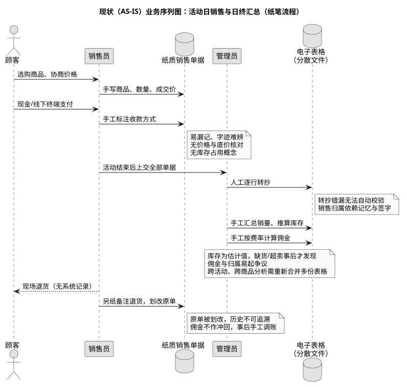
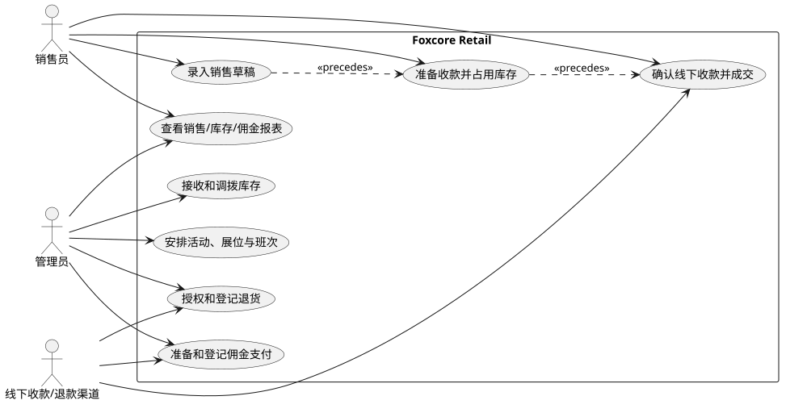
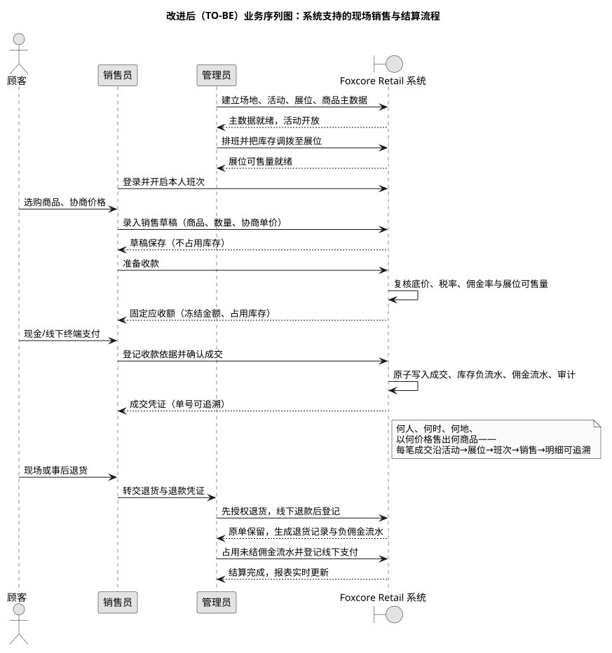

> 作业文档与图纸仓库：https://github.com/xingchenyd/foxcore-retail —— 文档位于 `docs/`，图纸位于 [docs/diagrams](https://github.com/xingchenyd/foxcore-retail/tree/main/docs/diagrams)（实体类图 class-diagram.png/svg、物理 ERD physical-erd.png、概念 ERD core-barker.png/svg、架构图、业务序列图、用例图、状态图等全套 .puml/.svg/.png）。

# 01 愿景与业务分析

> **2026-10-24 课程复核入口**：[课程知识与项目映射](course-review/课程知识与项目映射.md)与[本轮可编辑图册](course-review/diagrams/)按当前合同区分业务目标、实现和验证证据。本文原 `diagrams/` 图片及对应 PDF 保留为历史材料，当前角色、状态守卫和物理关系请优先核对新图。现状流程是案例文献重建，未因此完成实地访谈；成功度量是目标，不是实测成果。

| 文档属性 | 内容 |
|---|---|
| 文档名称 | Foxcore Retail 愿景与业务分析 |
| 当前版本 | 2.0 |
| 编写日期 | 2026-09-27 |
| 文档状态 | 已发布 |
| 关联文档 | [02-SRS 需求规格](02-SRS.md) · [03-SDD 设计说明](03-SDD.md) · [04-数据库设计](04-database.md) |

> 来源声明：业务背景取自 Foxcore Retail A 第 2–3 页、B 第 1–3 页。本文为独立教学实现，与案例企业无官方关联；所有样例人物、价格和业绩均为合成数据。

## 修订历史

| 版本 | 日期 | 修订内容 | 作者 |
|---|---|---|---|
| 1.0 | 2026-09-27 | 初版：问题与目标、角色范围、业务用例概述 | 项目组 |
| 2.0 | 2026-09-27 | 扩充为正式业务分析文档：补充现状流程与序列图、问题清单、愿景目标与度量、干系人分析、业务用例规约、AS-IS/TO-BE 对比、业务规则汇总与术语表 | 项目组 |

## 1 引言

### 1.1 编写目的

本文档定义 Foxcore Retail 现场销售管理系统的**项目愿景**与**业务模型**，回答三个问题：当前业务如何运作（AS-IS）、为什么必须改变（问题与影响）、改变后应达到什么状态（TO-BE 愿景与度量）。它是后续 [软件需求规格（SRS）](02-SRS.md) 与 [软件设计说明（SDD）](03-SDD.md) 的业务依据：SRS 中的每条功能需求都应能回溯到本文档的某个业务问题、业务目标或业务用例。

### 1.2 项目背景

Foxcore 是一家从事现场活动销售的零售企业：在展会、市集、社区市集等**七类活动**中设置展位，由销售顾问当班销售商品。业务规模具有三个特征：

1. **人员多**：现场销售顾问 17 名，同一天可能有多名顾问在不同展位当班；
2. **品类多**：在售商品超过 28 种，价格允许现场协商，但不得低于管理员设定的最低售价；
3. **地点散**：同一周末可能参加多个活动，一个活动设置多个展位，销售归属需要精确到"活动 → 展位 → 班次 → 销售员"。

当前的记录方式以纸笔为主、电子表格为辅，难以支撑上述规模的精细化经营。

### 1.3 适用读者

| 读者 | 关注点 | 建议阅读 |
|---|---|---|
| 业务负责人 / 管理员（OWNER） | 系统能否解决佣金争议、库存不准、分析困难 | 第 2、3、6 章 |
| 现场销售顾问（SALESPERSON） | 日常操作是否更省事、佣金是否透明 | 第 3、5 章 |
| 需求/开发人员 | 业务规则与范围边界 | 全文，尤其第 5、6 章 |
| 课程评审 / 教师 | 建模完整性 | 全文 |

### 1.4 参考资料

- Foxcore Retail A 案例原文（第 2–3 页）：现状与数据要求；
- Foxcore Retail B 案例原文（第 1–3 页）：实体与关系要求；
- [02-SRS](02-SRS.md)：来源需求追踪（CASE-01 至 CASE-12）；
- [05-STD](05-STD.md)：面向本业务目标的验收测试。

## 2 现状分析与问题陈述

### 2.1 现状业务流程（AS-IS）

一个典型活动日的现状流程如下（图示见 [2.2 现状业务序列图](#22-现状业务序列图asis)）：

1. 活动前，管理员用表格登记活动、展位和商品清单，为每位销售顾问手工排班；
2. 开场时，销售员从管理员处领取商品实物，**口头/纸质交接**，库存数量以估计为主；
3. 顾客选购时，销售员在纸质单据上**手写**商品、数量和协商后的价格；
4. 顾客以现金或线下终端付款，销售员在单据上标注收款方式；**没有任何系统机制核对成交价与最低售价、可售库存量**；
5. 活动结束，销售员上交全部纸质单据，剩余实物交回；
6. 管理员**人工逐行转抄**单据到电子表格，再手工汇总销量、推算库存、按费率计算佣金；
7. 发生退货时，销售员划改原单、另纸备注；**原单被破坏，退款与佣金不作系统冲回**；
8. 月末/季末，管理员需要**手工合并多份表格**才能回答"哪个活动、哪类商品、哪位顾问表现最好"。

### 2.2 现状业务序列图（AS-IS）

图源：[business-sequence-asis.puml](diagrams/business-sequence-asis.puml)

### 2.3 问题清单

| 编号 | 问题 | 根因 | 业务影响 |
|---|---|---|---|
| P-01 | 销售漏记、字迹难辨 | 现场忙碌时手工记录 | 佣金与库存估计不可靠，直接损失信任 |
| P-02 | 无价格与库存校验 | 纸单无法实时核对 | 低于底价成交、展位超卖事后才发现 |
| P-03 | 收款归属争议 | 销售归属依赖记忆与签字 | "这单是谁卖的"难以裁决，团队矛盾 |
| P-04 | 转抄错漏 | 人工二次录入 | 汇总数据失真，报表不可信 |
| P-05 | 库存为估计值 | 收付实物与记录脱节 | 缺货错失销售，积压占用资金 |
| P-06 | 退货破坏历史 | 划改原单 | 无法审计"原价卖了什么、退了多少" |
| P-07 | 跨活动分析困难 | 数据分散多表 | 商品/员工/活动维度对比需数天人工 |
| P-08 | 佣金计算易错 | 手工按费率核算 | 多算/漏算引发结算纠纷 |

### 2.4 业务影响汇总

上述问题共同导致三个层面的损失：**收入层**（超卖、缺货、错失销售）、**成本层**（人工汇总与对账耗时、退货纠纷处理）、**管理决策层**（缺乏可信数据支撑活动与人员决策）。改进的核心不是"把纸换成屏幕"，而是**把每一笔成交变成结构化、可追溯、不可篡改的业务事实**。

## 3 项目愿景

### 3.1 愿景陈述

> 在一个活动密集的周末，Foxcore 的每一位销售顾问都能在数秒内完成一笔合规的成交记录；管理员打开系统即可看到**实时、可信、可追溯**的销售、库存与佣金数据——每一笔成交都能回答：**何人、何时、在何地、以何价格、销售了何商品**。

### 3.2 业务目标与成功度量

| 编号 | 业务目标 | 成功度量 | 现状基线 |
|---|---|---|---|
| G-01 | 消除漏记与转抄错漏 | 成交 100% 系统录入，汇总零人工转抄 | 纸单 + 手工转抄 |
| G-02 | 成交全程可追溯 | 每笔成交沿 `活动→展位→班次→销售→明细` 可定位，含价格/税率/佣金率快照 | 无法追溯 |
| G-03 | 库存账实一致 | 展位可售量实时准确，收款前即占用，过账后扣减 | 事后估计 |
| G-04 | 佣金无争议 | 正/负佣金流水自动计提，结算有据可查 | 手工计算 |
| G-05 | 多维分析即时化 | 按活动/商品/员工维度的报表与导出秒级可得 | 数天人工合并 |
| G-06 | 退货不破坏历史 | 原单永久保留，退货与佣金冲回自动关联 | 划改原单 |

### 3.3 系统范围（In Scope）

- 主数据管理：场地、活动（七类）、展位、商品（批发成本 + 最低售价）、销售顾问档案；
- 排班与班次：计划时段、开班/关班、一班一展位；
- 库存管理：主仓收货、库位间调拨、盘点调整、可售量占用；
- 现场销售：草稿 → 准备收款（核价/冻结）→ 登记线下收款 → 成交过账；
- 退货与更正：授权 → 线下退款 → 登记过账、良品/损坏品区分处理；
- 佣金管理：正负流水计提、结算准备、线下支付登记；
- 报表与导出：活动/商品/员工三维度聚合、CSV 导出；
- 账户与审计：角色账户、一次性临时密码、会话与 CSRF 防护、关键操作审计。

### 3.4 非目标与约束（Out of Scope）

1. **不接入银行卡网关**：系统只记录线下收/退款的确认事实，不执行资金转账、不保存卡号；
2. **顾客不注册账号**：顾客是线下参与者，不与系统交互；
3. **税率与佣金率由管理员确认**：系统内的示例费率不表示法定税率；
4. **本实现为独立教学版本**：与案例企业无官方关联，数据为合成数据；
5. 教学定位下的取舍：单仓库部署、单一货币（CAD）、单一业务时区（`America/Toronto`），不追求多租户与国际化。

## 4 干系人分析

| 干系人 | 在业务中的位置 | 关心的问题 | 系统中的角色 |
|---|---|---|---|
| 管理员 | 经营者兼现场统筹 | 佣金准确、库存可信、活动盈亏一目了然 | `OWNER`（全权） |
| 销售顾问 | 现场成交执行者 | 录入快、归属清、佣金透明、不被无关数据干扰 | `SALESPERSON`（限本人） |
| 顾客 | 购买者/退货者 | 退款有依据、处理不扯皮 | 不注册，线下参与 |
| 外部收款渠道 | 现金/线下终端 | 不参与系统 | 仅作为线下事实来源 |
| 教师/课程评审 | 教学评价者 | 模型与实现的完整性、可验证性 | 文档读者 |

## 5 业务建模

### 5.1 业务用例模型

业务用例图如下（图源：[business-usecases.puml](diagrams/business-usecases.puml)）：

业务用例清单与简要说明：

| 编号 | 业务用例 | 主参与者 | 目标简述 |
|---|---|---|---|
| BUC-01 | 安排活动、展位与班次 | 管理员 | 活动前完成场地/展位建置与人员排班 |
| BUC-02 | 接收和调拨库存 | 管理员 | 主仓收货并把实物交接至展位，账实一致 |
| BUC-03 | 录入销售草稿 | 销售员 | 把顾客成交意向快速结构化记录 |
| BUC-04 | 准备收款并占用库存 | 销售员 | 收款前核价、冻结金额、锁定可售量 |
| BUC-05 | 确认线下收款并成交 | 销售员 | 登记收款事实，原子生成成交/库存/佣金记录 |
| BUC-06 | 授权和登记退货 | 管理员 | 先授权后退款，原单保留、佣金冲回 |
| BUC-07 | 准备和登记佣金支付 | 管理员 | 占用未结流水、登记线下支付，防止重复结算 |
| BUC-08 | 查看销售/库存/佣金报表 | 管理员、销售员 | 按维度即时聚合，销售员仅见本人范围 |

用例间的依赖关系：销售主线为 `BUC-03 → BUC-04 → BUC-05`（草稿先行、准备收款次之、确认成交最后）；线下收款/退款渠道作为外部参与者出现在收款、退货与佣金支付三个环节。

### 5.2 改进后业务流程（TO-BE）

改进后的流程（图示见 [5.3 改进后业务序列图](#53-改进后业务序列图to-be)）：

1. **活动前**：管理员在系统中建立场地、活动、展位、商品与员工档案，确认活动税率与员工佣金率，排班并把库存从主仓调拨至展位——**基础数据一次录入，全程复用**；
2. **开班**：销售员在计划时段内登录系统开启本人班次——班次即销售归属的载体；
3. **成交中**：销售员录入草稿（商品、数量、协商单价）→ 点击准备收款，**系统复核底价、税率、佣金率与展位可售量**，冻结应收金额并占用库存 → 顾客线下支付后，销售员登记现金实收或终端参考号 → **系统在同一事务内**写入成交、库存负流水、佣金流水与审计；
4. **异常路径**：未成交可取消并释放占用；已过账的交易走退货：管理员先取得授权，线下退款后登记，**原单保留**、良品回库、损坏品不回可售、佣金自动冲回；
5. **结算与分析**：管理员按销售员结算佣金（先占用全部未结流水，登记线下支付）；报表按活动/商品/员工维度实时聚合，支持 CSV 导出核对。

### 5.3 改进后业务序列图（TO-BE）

图源：[business-sequence-tobe.puml](diagrams/business-sequence-tobe.puml)

### 5.4 AS-IS 与 TO-BE 对比

| 维度 | 现状 AS-IS | 改进后 TO-BE |
|---|---|---|
| 记录方式 | 纸笔记录商品、数量和价格；日终人工转抄 | 销售员登录，关联当前班次，录草稿并准备收款 |
| 价格控制 | 无校验，低于底价事后才发现 | 准备收款时服务器重新核价，低于底价拒绝 |
| 库存状态 | 未明确收款前的库存状态，事后估计 | 准备收款冻结金额、占用展位库存；过账后才减少实物 |
| 销售归属 | 依赖记忆与签字，归属易争议 | 活动、班次、人员、商品和佣金流水在同一数据库关联 |
| 退货更正 | 划改原单，历史丢失 | 保留原单，另建退款授权、退货记录和负佣金流水 |
| 佣金核算 | 手工按费率计算 | 正负流水自动计提，结算占用防重复 |
| 多维分析 | 手工合并多份表格，耗时数天 | 服务端实时聚合，秒级可得，可导出 |
| 异常防护 | 无 | 幂等键防重复收款；审计日志记录关键操作 |

### 5.5 核心业务协同（文字规约）

1. 管理员建场地、活动、展位、商品和销售员，确认活动税率及员工佣金率；
2. 管理员排班并把实物从主仓交接到展位；销售员在计划时段内开班；
3. 销售员录入商品、数量和协商单价；系统保存草稿。准备收款时服务器重新核价、验库存并冻结应收金额；
4. 销售员在线下收款并登记现金实收或终端参考号。系统原子写入成交、库存负流水、佣金正流水及审计。响应丢失时使用原幂等键或按单号查询，避免二次收款；
5. 管理员先取得退款授权，再操作线下退款，随后登记退货；佣金冲回形成负流水。结佣先占用全部未结流水，再登记线下付款。

> 上述收款、退款和佣金规则是为可运行系统作的 **DEC/EXT** 设计，并非案例原文规定；状态与异常路径见 [SRS](02-SRS.md) 和 [SDD](03-SDD.md)。

## 6 业务规则汇总

| 编号 | 规则 | 来源 |
|---|---|---|
| BR-01 | 每笔销售必须归属一个"活动 + 展位 + 班次 + 销售员"组合，系统按班次推导归属 | CASE-06/07/10 |
| BR-02 | 成交单价不得低于商品最低售价；准备收款时以**当时生效**的底价复核 | CASE-04 |
| BR-03 | 展位可售量 = 在手量 − 占用量，任何时点不得为负 | EXT |
| BR-04 | 收款前必须"准备收款"（冻结金额、占用库存）；未登记线下收款依据不得过账 | EXT |
| BR-05 | 已过账交易不可修改/删除；更正一律走退货授权流程 | EXT |
| BR-06 | 佣金按活动/员工费率以 bps 整数化计提，退货按比例生成负佣金 | DEC-03 |
| BR-07 | 现金实收不得低于应收；外部终端支付必须登记参考号 | DEC-04 |
| BR-08 | 所有资金、库存、佣金变更操作写审计日志，与业务动作同事务提交 | FR-08 |
| BR-09 | 佣金结算先占用全部未结流水；净额非正不得发起支付登记 | FR-06 |
| BR-10 | 业务日期按 `America/Toronto` 判定，操作时刻以 UTC 存储 | DEC-01 |
| BR-11 | 金额以十进制字符串输入（最多两位小数），库内整数分运算 | DEC-02 |
| BR-12 | 写命令携带 UUID 幂等键：同键同体重试返回同结果，同键异体拒绝 | NFR-02 |

## 7 术语表

| 术语 | 英文/系统对应 | 定义 |
|---|---|---|
| 活动 | Event | 在某场地某日期举办的销售活动，分七类 |
| 展位 | Booth | 活动内的销售点位，一个活动至少一个 |
| 班次 | Shift | 销售员在某展位的计划工作时段；一班只在一个展位 |
| 销售草稿 | DRAFT Sale | 已录入未准备收款的交易，可编辑，不占库存 |
| 准备收款 | CHECKOUT | 已核价冻结、占用库存、等待线下收款的交易 |
| 已过账 | POSTED Sale | 已登记收款并生效的成交，不可修改 |
| 占用 | Hold / Reserved | 为待收款交易锁定的库存量 |
| 库存流水 | Stock Movement | 收货/调拨/盘点/销售/退货引起的数量变更记录 |
| 佣金流水 | Commission Line | 按成交/退货计提的正/负佣金记录 |
| 幂等键 | Idempotency Key | 客户端生成的 UUID，用于写命令重试去重 |
| 审计 | Audit Event | 关键业务操作的时间、操作者、对象记录 |
