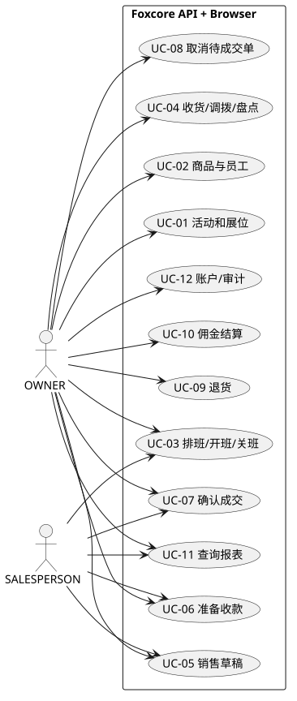
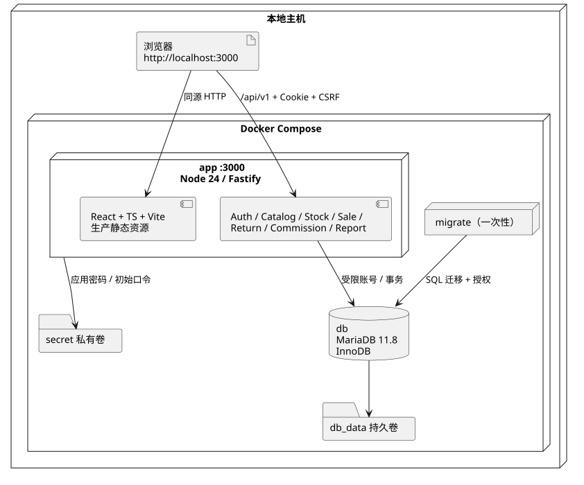
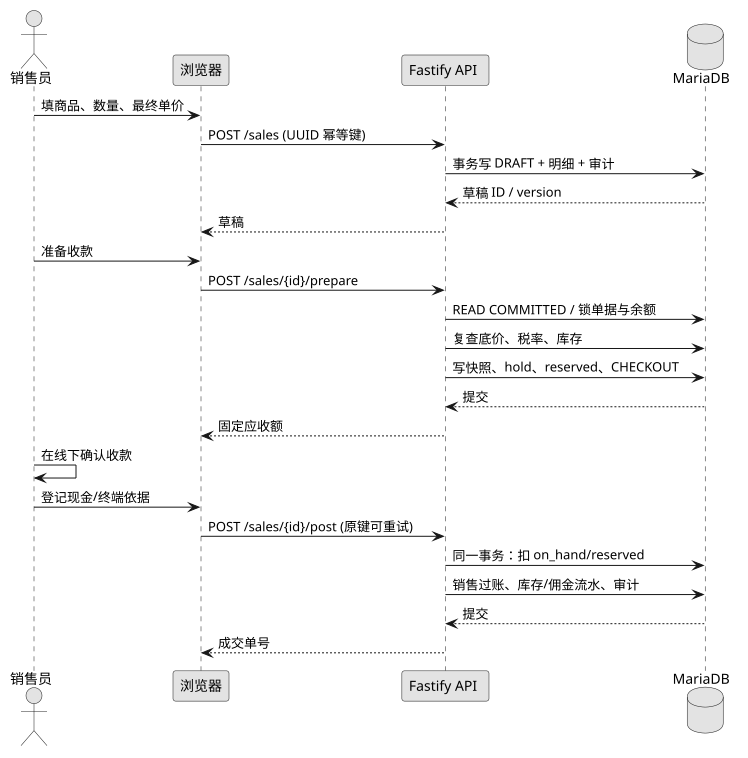
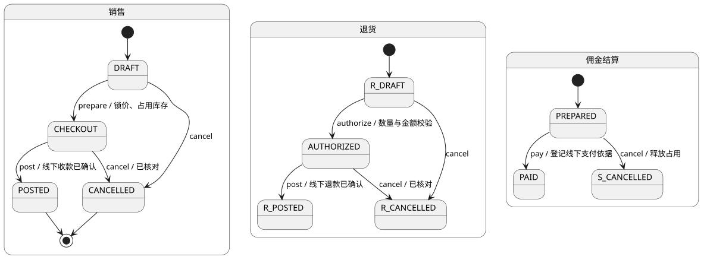
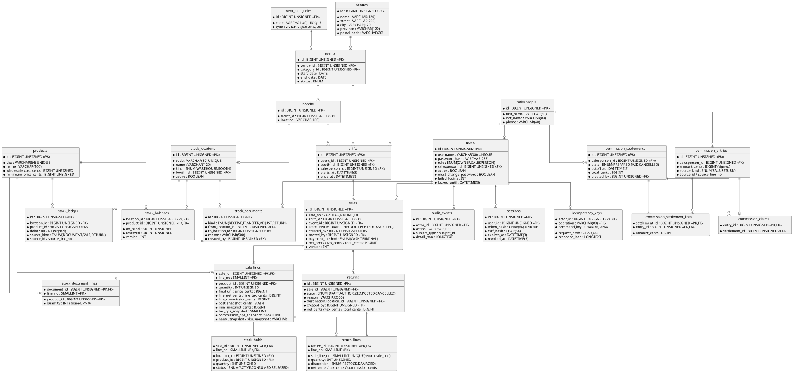

<!-- foxcore-fixes-current -->
> 本轮修复：实现与验证状态以 [修复说明](fixes/README.md)、[决策](fixes/decisions.md)、[验证记录](fixes/verification.md) 和 `use-cases.json` 为准。下文未更新的历史运行统计不代表本轮通过。PDF/既有图片是旧基线派生物，尚未重新生成；修复后以 Markdown、源码及新合同为准。
<!-- /foxcore-fixes-current -->

# 03 系统设计说明（SDD）

**Foxcore Retail — 现场零售运营管理系统 · 系统设计文档**

---

## 文档信息

| 项目 | 内容 |
|---|---|
| 文档名称 | Foxcore Retail 系统设计说明（Software Design Description, SDD） |
| 项目名称 | Foxcore Retail — 模块化单体现场零售运营系统 |
| 文档编号 | FC-SDD-001 |
| 版本 | 1.1 |
| 状态 | 基线发布（Baselined） |
| 编制日期 | 2026-09-27 |
| 编制/维护 | Foxcore Retail 课程项目组 |
| 上游文档 | [01 愿景与业务建模](01-vision-business.md)、[02 软件需求规格 SRS](02-SRS.md) |
| 下游文档 | [04 数据库设计与 ERD](04-database.md)、[05 测试与验收说明 STD](05-STD.md)、[06 用户操作手册](06-user-operations.md)、[07 本地部署运维](07-deployment-local.md) |
| 适用读者 | 系统架构评审人员、开发工程师、测试工程师、课程评审教师 |

## 修订历史

| 版本 | 日期 | 修订人 | 修订说明 | 影响章节 |
|---|---|---|---|---|
| 0.1 | 2026-09-20 | 项目组 | 初稿：模块划分与部署形态 | 全篇 |
| 0.5 | 2026-09-24 | 项目组 | 补充交易事务顺序、并发控制与幂等设计 | 2.3、4.4 |
| 1.0 | 2026-09-27 | 项目组 | 按 SRS 基线与 24 张物理表对齐，补充 ADR | 全篇 |
| 1.1 | 2026-09-27 | 项目组 | 按正式 SDD 结构重组：4+1 架构视图、数据设计索引、可追踪性矩阵；补充云端部署视图与全部架构图渲染件 | 1、3、4、5、6、7 |

## 目录

1. [引言](#1-引言)
2. [特定需求](#2-特定需求)
3. [架构原理](#3-架构原理)
4. [架构视图（4+1）](#4-架构视图41)
5. [数据设计](#5-数据设计)
6. [用户界面设计](#6-用户界面设计)
7. [可追踪性](#7-可追踪性)
8. [附录 A：架构决策记录（ADR）](#附录-a架构决策记录adr)

---

## 1 引言

### 1.1 目的

本文档描述 Foxcore Retail 系统的**软件设计**，将 [SRS](02-SRS.md) 中定义的功能需求（FR）与非功能需求（NFR）转化为可实现、可验证的技术设计。本文档回答三个问题：

1. 系统被分解成哪些构件，各构件的职责边界是什么；
2. 这些构件如何协作完成一次关键业务交易（尤其是过账销售这一强一致性场景）；
3. 为什么做出这些技术选择，代价是什么。

本文档与 [01 愿景与业务建模](01-vision-business.md)（为什么做）、[02 SRS](02-SRS.md)（做什么）共同构成需求—设计的完整链条，并向下游的 [04 数据库设计](04-database.md)、[05 测试说明](05-STD.md)、[06 操作手册](06-user-operations.md)、[07 部署运维](07-deployment-local.md) 提供设计基线。

### 1.2 范围

**本文档覆盖的设计范围：**

- 应用的分层结构与模块划分（8 个服务端模块 + 单页前端）；
- 4+1 架构视图：用例视图、逻辑视图、交互视图、进程视图、物理/部署视图；
- 关键事务的并发控制、幂等性与审计策略；
- 金额计算、快照与舍入规则的服务层实现约定；
- 安全设计：认证、会话、CSRF、角色授权与响应头；
- 数据设计的总体原则（物理细节见 04）；
- 界面设计的导航结构与交互原则（细节见 06）；
- 架构决策记录（ADR）及其理由与代价。

**本文档不覆盖的内容：**

- 业务愿景、业务流程现状与改进分析（见 01）；
- 用例规约、功能需求编号与验收准则（见 02）；
- 完整的表结构、数据字典、归一化推导与 DDL（见 04）；
- 测试用例步骤、实测结果与缺陷记录（见 05）；
- 逐步操作截图与业务人员作业指导（见 06）；
- 安装命令、备份恢复与故障处置流程（见 07、[08 云端部署](08-deployment-vercel.md)）。

### 1.3 定义、缩写与缩略语

| 术语/缩写 | 全称或定义 |
|---|---|
| **Fastify** | Node.js 高性能 Web 框架，本项目服务端基础框架（v5） |
| **SPA** | Single Page Application，单页应用；本项目前端为 React 单页应用 |
| **BFF** | Backend for Frontend；本项目同源 Fastify 同时承载 API 与静态资源 |
| **Argon2id** | 现代密码散列算法，本项目用于口令存储 |
| **CSRF** | Cross-Site Request Forgery，跨站请求伪造 |
| **CSP** | Content Security Policy，内容安全策略 |
| **bps** | basis point，万分之一；税率与佣金率的存储单位（如 1300 bps = 13%） |
| **cents** | 金额最小单位（分）；所有金额在服务端以 `bigint` 整数分存储与计算 |
| **half-up** | 四舍五入（.5 向上进位）的舍入模式，本项目税费与佣金计算采用 |
| **Idempotency-Key** | 幂等键；业务写请求必须携带的 UUID 请求头，用于重试去重 |
| **READ COMMITTED** | MariaDB/InnoDB 事务隔离级别之一，本项目事务默认级别 |
| **FOR UPDATE** | InnoDB 行级排他锁定语法，用于关键行读取加锁 |
| **不变量（Invariant）** | 任何时刻都必须成立的数据一致性断言，由 `db/check-invariants.sql` 核查 |
| **OWNER / SALESPERSON** | 系统两种角色：业主管理员 / 现场销售员 |
| **4+1 视图** | Kruchten 提出的架构描述模型：用例、逻辑、进程、物理、开发视图 |
| **ADR** | Architecture Decision Record，架构决策记录 |
| **模块化单体** | Modular Monolith：单一可部署进程，内部按领域模块严格分层与隔离 |

### 1.4 参考文献

| 编号 | 文献 | 用途 |
|---|---|---|
| REF-01 | Foxcore Retail A — Designing a Database（课程案例） | 概念数据模型基线 |
| REF-02 | Foxcore Retail B — Database Implementation（课程案例） | 九核心实体与物理实现基线 |
| REF-03 | IEEE Std 1016-2009, *Standard for Information Technology — Systems Design — Software Design Descriptions* | 本文档结构依据 |
| REF-04 | P. Kruchten, *The 4+1 View Model of Architecture*, IEEE Software, 1995 | 第 4 章架构视图模型 |
| REF-05 | [02 软件需求规格](02-SRS.md) | 需求基线（FR/NFR/UC） |
| REF-06 | [OpenAPI 合同](openapi.json) | API 接口契约（45 个路径） |
| REF-07 | MariaDB 11.8 Reference Manual | 事务、锁与 DDL 隐式提交行为 |
| REF-08 | [08 Vercel 云端部署](08-deployment-vercel.md) | 云端形态的部署视图补充 |

### 1.5 概述

本文档第 2 章描述各系统特性的设计（构件职责、事务边界、错误处理）；第 3 章说明架构风格与决策理由；第 4 章以 4+1 视图给出系统全貌；第 5、6 章分别索引数据设计与界面设计的详细文档；第 7 章给出需求—设计—测试的三向追踪矩阵；附录 A 汇总 12 项架构决策。

设计的核心命题是：**在一个单机可部署的模块化单体内，用关系数据库的事务与约束，保证现场零售场景下"库存不超卖、金额不错算、操作可追溯"这三条底线**。所有设计取舍均围绕该命题展开。

---

## 2 特定需求

本章将 SRS 的功能需求映射为系统特性（System Feature, SF），逐项给出设计要点。

### 2.1 用户特征

| 角色 | 技术特征 | 使用环境 | 设计应对 |
|---|---|---|---|
| **OWNER（业主管理员）** | 具备基本 Web 操作能力；需管理主数据、库存、退货授权、佣金结算与审计 | 后台办公电脑（桌面浏览器）为主，偶用手机查看报表 | 全量导航可见；管理类接口强制角色校验；报表支持 CSV 导出；首登录强制改密 |
| **SALESPERSON（现场销售员）** | 仅需在班次内快速录单成交；对商品价格与成本不敏感 | 展会现场，桌面或手机浏览器，网络可能不稳定 | 导航裁剪（不可见退货、审计）；默认进入销售工作台；按钮尺寸适配移动端；写操作强制幂等键以免网络重试造成重复过账 |
| **运维/部署人员** | 熟悉 Docker Compose 与命令行 | 服务器或本地开发机 | 一键 `docker compose up`；密钥由 Secret 卷注入；健康检查端点 `/health/ready` |

### 2.2 系统特性总览

| 编号 | 系统特性 | 实现构件 | 对应需求 | 持久化主要表 |
|---|---|---|---|---|
| SF-01 | 身份认证与会话管理 | `auth.ts` | UC-13（认证扩展） | `users`, `sessions`, `idempotency_keys`, `audit_events` |
| SF-02 | 主数据管理（场地/活动/展位/商品/员工/班次） | `catalog.ts`, `catalog-updates.ts` | UC-01, UC-02, UC-03 | `venues`, `events`, `booths`, `products`, `salespeople`, `shifts`, `event_categories` |
| SF-03 | 库存与库内作业（收货/调拨/盘点/占用） | `inventory.ts` | UC-04 | `stock_locations`, `stock_documents`, `stock_document_lines`, `stock_balances`, `stock_ledger`, `stock_holds` |
| SF-04 | 销售交易（草稿/准备收款/过账/取消） | `sales.ts` | UC-05, UC-06, UC-07, UC-08 | `sales`, `sale_lines`, `stock_holds`, `commission_entries` |
| SF-05 | 退货与退款 | `returns.ts`, `return-target.ts` | UC-09 | `returns`, `return_lines`, `commission_entries` |
| SF-06 | 佣金计提与结算 | `commissions.ts` | UC-10 | `commission_entries`, `commission_settlements`, `commission_settlement_lines`, `commission_claims` |
| SF-07 | 报表、审计与导出 | `reports.ts`（报表）、`index.ts`（审计查询）、`core.ts`（审计写入） | UC-11, UC-12 | 只读查询 + `audit_events` |
| SF-08 | 平台服务（事务、金额、幂等、审计、错误） | `db.ts`, `amounts.ts`, `core.ts` | NFR-PERF, NFR-REL, NFR-SEC | `idempotency_keys`, `audit_events` |

### 2.3 系统特性设计

#### 2.3.1 SF-01 身份认证与会话管理

**设计要点**

- 口令存储使用 **Argon2id**；不以任何形式保存明文或可逆加密口令。
- 登录成功后生成 **32 字节**密码学安全随机令牌；数据库仅保存该令牌的 **SHA-256 摘要**（`token_hash CHAR(64)`），即使库被读取也无法反推会话令牌。
- 会话 Cookie 属性：`HttpOnly`（脚本不可读）、`SameSite=Lax`、`Path=/`；本地 HTTP 下 `Secure=false`，迁移到 HTTPS 时必须配置 `COOKIE_SECURE=true` 且 `PUBLIC_ORIGIN` 与实际同源地址一致。
- 会话有效期：**绝对过期 12 小时**，**空闲过期 30 分钟**；修改口令、停用账号时撤销该用户全部现存会话。
- 写请求执行 **CSRF 双重提交校验**，并核对 `Origin` 头在允许集合内。
- 登录失败计数与锁定：`failed_logins` 递增，`locked_until` 到期自动解锁，抵御在线口令爆破。

**事务与错误处理**

认证写操作（登录、登出、改密）在单连接事务内完成；失败的登录不泄露"用户名存在/口令错误"的区别，统一返回 401 与通用消息，避免账号枚举。

#### 2.3.2 SF-02 主数据管理

**设计要点**

- 六类主数据各自提供列表查询与创建接口；商品支持 `PATCH` 局部更新（价格/成本策略调整），其余主数据一经被业务引用即不提供删除，避免历史单据悬空引用。
- **复合外键链**保证归属不可篡改：`booths UNIQUE(id, event_id)` → `shifts(booth_id, event_id)` → `sales(shift_id, event_id)`。这使得"把一笔销售强行挂到别的活动下"在数据库层面即被拒绝。
- 活动开放前置校验：至少存在一个有效展位，否则开放请求返回 409（业务规则 BR-05）。
- 七类活动类别（trade show / rib fest / waterfront festival / music festival / beer festival / sporting event / street festival）作为**种子数据**写入 `event_categories`，不提供用户维护入口。

**事务与错误处理**

主数据创建为短事务；唯一键冲突（如 SKU 重复、同一活动下展位位置重复）映射为 409 并给出可定位的字段信息。

#### 2.3.3 SF-03 库存与库内作业

**设计要点**

- **两类库位**：`WAREHOUSE`（主仓，不关联展位）与 `BOOTH`（展位库位，必关联展位），由 `CHECK (kind='WAREHOUSE' AND booth_id IS NULL) OR (kind='BOOTH' AND booth_id IS NOT NULL)` 强制。
- **余额与流水分离**：`stock_balances` 是**可重算的缓存**（`on_hand`, `reserved`），`stock_ledger` 是**只增不改的权威流水**（`delta` 带符号，`CHECK (delta <> 0)`）。二者由不变量 I-02 约束一致。
- **可售量定义**：`available = on_hand − reserved`；`CHECK (on_hand >= reserved)` 保证可售量非负。
- **单据驱动**：收货（RECEIVE）、调拨（TRANSFER）、盘点（ADJUST）、退货（RETURN）四类库存单据均需理由文本；调拨按当前实现为**已完成实物交接后的原子登记**：请求必须包含 `handoverConfirmed=true`，同一事务扣来源余额、加目标余额并写双向流水；不存在在途库存和二次接收接口。
- **占用（hold）**：销售准备收款阶段创建 `stock_holds`，状态 `ACTIVE`；过账时转 `CONSUMED` 并使 `on_hand` 与 `reserved` 同量下降；取消时转 `RELEASED` 并归还 `reserved`。

**事务与错误处理**

库存单据写入与余额更新在同一事务内；`stock_balances.version` 配合乐观校验，`stock_ledger` 的 `UNIQUE (source_kind, source_id, source_line_no, location_id)` 保证同一来源不重复入账。

#### 2.3.4 SF-04 销售交易（核心特性）

**状态机**：`DRAFT → CHECKOUT → POSTED`，任一前序状态可 `CANCELLED`。

| 转移 | 触发接口 | 关键动作 |
|---|---|---|
| → DRAFT | `POST /api/v1/sales` | 校验班次 ACTIVE、活动 OPEN，落草稿行 |
| DRAFT → CHECKOUT | `POST /api/v1/sales/{id}/prepare` | 重算底价/税率/佣金率/可售量，创建 ACTIVE hold（仅增 `reserved`，不动 `on_hand`） |
| CHECKOUT → POSTED | `POST /api/v1/sales/{id}/post` | 记录线下收款确认，`on_hand` 与 `reserved` 同量下降，写负库存流水、正佣金流水、成交时间与审计 |
| → CANCELLED | `POST /api/v1/sales/{id}/cancel` | 释放或冲销 hold；已 POSTED 单据不可取消，须走退货 |

**准备收款事务的加锁顺序（严格固定，防止死锁）**

```
1. idempotency_keys（幂等行，最先）
2. events（校验活动 OPEN）
3. shifts → sales（校验班次与单据状态）
4. products（重读当前底价与成本）
5. stock_balances（展位库位余额，最后）
```

事务内**重新读取**当前底价、税率、佣金率、活动/班次状态与可售量——不使用请求体携带的价格作为成交依据。只增加 `reserved`，保留 `on_hand`，因此"待收款"期间的实物仍在展位，符合现场作业语义（ADR-04）。

**快照机制**：每条 `sale_lines` 保存 `final_unit_price_cents`、`name_snapshot`、`sku_snapshot`、`cost_snapshot_cents`、`min_snapshot_cents`、`tax_bps_snapshot`、`commission_bps_snapshot`。已过账历史不受后续主数据变更影响（ADR-03）。

**外部收款边界**：系统仅登记"已收到款项"的确认信息（现金实收额或终端参考号），**不发起、不对接任何银行卡或线上支付渠道**；收款动作不在数据库事务内。

#### 2.3.5 SF-05 退货与退款

**状态机**：`DRAFT → AUTHORIZED → POSTED`，可 `CANCELLED`。

- 退货**锁定原销售单及其明细行**，按累计已退数量分摊原单的税额与佣金，生成**负向**佣金流水；
- 选择 `RESTOCK`（良品）时按指定目标库位加回可售库存，`DAMAGED`（损坏）不入可售；
- 累计退货数量超过原销量时拒绝（409），由不变量 I-05 复核；
- 退款参考号由管理员在线下完成退款后登记，系统不触发资金动作。

#### 2.3.6 SF-06 佣金计提与结算

- **计提**：过账销售时按行的 `commission_bps_snapshot` 生成正向 `commission_entries`；过账退货时按分摊比例生成负向条目。`UNIQUE (source_kind, source_id, source_line_no)` 保证同一来源只计提一次。
- **结算**：`PREPARED → PAID`，可 `CANCELLED`。准备结算时**锁定员工并占用其当前全部未结正负流水**（写入 `commission_claims`，一笔流水只被一个结算占用）；取消准备释放占用；登记支付仅保存付款参考，不执行转账。
- 结算金额与明细金额合计由不变量 I-07 复核。

#### 2.3.7 SF-07 报表、审计与导出

- 报表按**活动 / 商品 / 销售员**三个维度汇总，**只计已过账销售并扣除已过账退货**；
- 维度白名单校验 + **参数化 SQL**；动态报表不允许拼接任意列名；
- CSV 导出限 OWNER；文本字段做**公式注入防护**（前置单引号或转义 `= + - @` 起始字符）；
- 毛利为**商品标准成本估算**（`final_unit_price − cost_snapshot`），不含活动费、差旅与工资，且销售员角色不可见（SRS NFR-SEC-03）；
- 关键写操作写入 `audit_events`（actor、action、subject、detail_json），管理员可分页查询。

#### 2.3.8 SF-08 平台服务

| 服务 | 设计约定 |
|---|---|
| **金额** (`amounts.ts`) | API 输入为 CAD 十进制字符串，内部转整数分 `bigint` 运算；税与佣金按 bps 计算并 **half-up** 取整；输出金额字段为整数分字符串；浏览器仅做格式化显示 |
| **事务** (`db.ts`) | 全程**同一连接**；隔离级别 `READ COMMITTED`；关键行 `FOR UPDATE`；捕获 `ER_LOCK_DEADLOCK`（errno 1213）、`ER_LOCK_WAIT_TIMEOUT`（1205）、`ER_CHECKREAD`（1020）三类错误，回滚后随机退避 20–70 ms，**最多 3 次尝试**（首次 + 最多 2 次重试） |
| **幂等** (`core.ts`) | 任意业务 POST 必须携带 `Idempotency-Key`（UUID）；键、请求摘要与响应在**同一事务**提交；相同键相同内容返回首次响应（不重复过账），相同键不同内容返回 409 |
| **审计** | 与业务数据同事务写入，保证"有业务必有审计" |
| **错误** | 统一 `{code, message, requestId}`；已识别输入/状态/权限错误映射 400/401/403/404/409；500 **不回显 SQL 栈与内部消息** |

### 2.4 性能与其他非功能需求的设计应对

| SRS 编号 | 需求 | 设计应对 | 验证方式 |
|---|---|---|---|
| NFR-PERF-01 | 现场录单响应可接受 | 单进程内存态路由；金额计算纯整数运算；列表默认分页 20 条；选择器最多载入 100 项 | STD TC-014 |
| NFR-PERF-02 | 并发抢最后一件不超卖 | 固定加锁顺序 + `FOR UPDATE` + 重试；不足量直接 409 | STD TC-007（20 并发 1 成功 19 冲突） |
| NFR-REL-01 | 重试不产生重复过账 | 幂等键与业务同事务提交 | STD TC-006 |
| NFR-SEC-01 | 口令不可反推 | Argon2id + 令牌仅存 SHA-256 摘要 | STD TC-002、代码审查 |
| NFR-SEC-02 | 越权访问被拒 | 角色中间件 + 销售员查询按 `salesperson_id` 限定 | STD TC-010 |
| NFR-SEC-03 | 成本不泄露给销售员 | 序列化层按角色裁剪字段 | STD TC-010 |
| NFR-AUD-01 | 关键操作可追溯 | 同事务审计写入 | STD TC-013 |
| NFR-MAIN-01 | 结构清晰可维护 | 模块化单体，模块间仅经服务层调用 | 类型检查 + 构建 |

### 2.5 设计约束

| 编号 | 约束 | 来源 | 影响 |
|---|---|---|---|
| DC-01 | 数据库为 MariaDB 11.8（InnoDB） | 课程案例 B | `FOR UPDATE`、CHECK、复合 FK 可用；DDL 隐式提交不可整体回滚 |
| DC-02 | 运行时 Node ≥ 24 | 项目 `.node-version` | 使用现代内置 API；Vercel 需指定运行时 |
| DC-03 | 单一可部署单元优先 | 教学与部署简易性 | 采用模块化单体，非微服务 |
| DC-04 | 本地一键启动不得手工配置口令 | 部署简易性要求 | 密钥走 Docker Secret 卷 / 环境变量 |
| DC-05 | 发布包不含课程原件与真实凭据 | 信息安全要求 | 构建与打包脚本排除敏感文件 |
| DC-06 | 单时区 `America/Toronto` | 业务现场单一 | 不做跨时区门店支持 |
| DC-07 | 不得改动既有本地部署流程 | 用户约束 | 云端适配全部以环境变量门控（见 08） |

---

## 3 架构原理

### 3.1 架构风格

系统采用 **模块化单体（Modular Monolith）**，具体形态为：**React SPA 前端 + 同源 Fastify API + MariaDB**，单进程、单端口（3000）对外服务。

```
浏览器 ──HTTP──> Fastify 单进程（同源）
                 ├─ /api/v1/*   JSON API（业务逻辑）
                 ├─ /*          静态资源（生产构建的 SPA）
                 └─ /health/*   健康检查
                        │
                        └─ mysql2 连接池 ──> MariaDB 11.8（仅容器内网可达）
```

### 3.2 决策理由

| 备选方案 | 评价 | 结论 |
|---|---|---|
| **模块化单体 + 同源静态托管** | 一次构建、一次部署；会话边界天然一致（无跨域 Cookie 问题）；事务在单进程内可控 | **采纳** |
| 前后端分离部署（SPA 独立域名 + 独立 API） | 需处理 CORS、跨站 Cookie、双份部署与版本对齐；对单组织现场系统收益有限 | 否决 |
| 微服务拆分（库存/销售/佣金各自服务） | 引入分布式事务与最终一致；本系统核心诉求恰是**强一致的库存与金额**，拆分会使复杂度与风险陡增 | 否决 |
| 嵌入式数据库（SQLite） | 无并发写事务能力，不满足"20 并发抢最后一件"的强一致要求 | 否决 |

### 3.3 关键质量属性策略

| 质量属性 | 策略 | 具体机制 |
|---|---|---|
| **一致性** | 把正确性放进数据库 | 事务 + 行锁 + CHECK + 复合外键 + 唯一键 + 不变量核查脚本 |
| **可靠性（重试安全）** | 幂等优先 | `Idempotency-Key` 与业务同事务；来源唯一键防重复入账 |
| **可审计性** | 写即记录 | `audit_events` 同事务；不可 UPDATE/DELETE 的流水表 |
| **安全性** | 纵深防御 | Argon2id、摘要令牌、CSRF、角色裁剪、CSP、no-store、参数化 SQL |
| **可移植性** | 环境无关 | 通用 Dockerfile + 环境变量；云端形态以 `VERCEL` 等变量门控，不改动本地路径 |
| **可维护性** | 显式边界 | 模块只经服务层交互；共享逻辑集中在 `core.ts` / `amounts.ts` |

---

## 4 架构视图（4+1）

### 4.1 用例视图（Use Case View）

描述系统为角色提供的能力边界。完整用例规约见 [02 SRS](02-SRS.md)；业务用例图见 [业务用例图](diagrams/business-usecases.svg)，系统用例图见 [系统用例图](diagrams/system-usecases.svg)。



**图 4-1 系统用例图**（源：`diagrams/system-usecases.puml`）

| 角色 | 可见能力 |
|---|---|
| OWNER | 全部 12 个用例，含主数据维护、库存作业、退货授权、佣金结算、报表导出、审计查询 |
| SALESPERSON | 登录、主数据只读、班次内销售（UC-08/UC-09）、本人佣金查询（UC-11）、报表查看（UC-12，不含成本口径） |

### 4.2 逻辑视图（Logical View）

按职责划分的构件与依赖方向（依赖自上而下，无环）。



**图 4-2 逻辑架构与部署结构**（源：`diagrams/architecture.puml`）

| 层 | 构件 | 职责 | 关键持久化 |
|---|---|---|---|
| 表现层 | `apps/web`（React 19 + TypeScript + Vite） | 角色化导航、表单、服务端数据查询、错误与状态显示 | 不保存认证令牌；已保存单据一律从服务器读取 |
| 接口层 | `apps/server/src/index.ts` | 路由注册、静态资源托管、健康检查、错误统一处理 | — |
| 领域服务层 | `auth.ts` | Argon2id、会话、角色与 CSRF 校验 | `users`, `sessions`, `audit_events` |
| | `catalog.ts` | 场地、活动、展位、商品、员工、班次；报表查询 | 六类主数据 + `event_categories` |
| | `inventory.ts` | 收货、调拨确认、盘点、余额与占用 | `stock_*` 全族 |
| | `sales.ts` | 草稿、占用、线下收款确认、过账、取消 | `sales`, `sale_lines`, `stock_holds` |
| | `returns.ts` | 授权、部分退货、良品/损坏去向、负佣金 | `returns`, `return_lines` |
| | `commissions.ts` | 正负计提、结算占用、付款登记 | `commission_*` |
| 平台层 | `db.ts` / `core.ts` / `amounts.ts` | 单连接事务、整数金额与舍入、幂等键、审计、错误模型 | `idempotency_keys`, `audit_events` |

**依赖规则**：领域服务之间**不互相直接调用数据库以外的私有状态**；跨模块共享逻辑必须下沉到平台层；表现层只能通过 HTTP API 访问领域逻辑。

### 4.3 交互视图（Interaction / Process View 中的时序）

关键交易——**准备收款并过账销售**的时序如下。



**图 4-3 销售准备收款与过账时序**（源：`diagrams/sale-sequence.puml`）

时序要点：

1. 客户端发起准备收款时携带 `Idempotency-Key`；服务端首先在同一事务中处理幂等行（命中且摘要一致则直接返回首次响应）；
2. 事务内依次校验活动状态、班次状态、商品底价与可售量，创建 `ACTIVE` 占用；
3. 客户端在线下完成收款后，携带收款确认调用过账；服务端将占用转为 `CONSUMED`，`on_hand` 与 `reserved` 同量下降，写入库存流水、佣金流水、成交时间与审计；
4. 任一步失败即整体回滚，占用不残留；网络不确定时客户端应以**同一幂等键**重试，而非重新发起新单。

### 4.4 进程视图（Process View）

描述运行时的并发、事务与锁行为。

| 方面 | 设计 |
|---|---|
| 进程模型 | 单 Node 进程；Fastify 事件循环处理请求；CPU 密集的 Argon2id 与金额计算为短任务 |
| 连接池 | `mysql2` 连接池；**业务事务强制从池中取出同一连接**并在其上开启事务 |
| 隔离级别 | `READ COMMITTED` |
| 加锁 | 关键行 `SELECT ... FOR UPDATE`；全局固定加锁顺序（幂等 → 活动 → 班次/销售 → 商品 → 余额） |
| 冲突处理 | 死锁（1213）、锁等待超时（1205）、并发读取冲突 → 回滚并最多重试 3 次；仍失败则返回 409，由客户端决定是否重试 |
| 幂等 | `(actor_id, operation, command_key)` 为主键；请求摘要 `request_hash` 不一致返回 409 |
| 并发验证 | 20 个并发请求争抢最后一件商品：恰 1 成功，19 个冲突（STD TC-007） |

**状态机**（完整状态源见 `diagrams/states.puml`）：



**图 4-4 核心实体状态机**（源：`diagrams/states.puml`）

- 活动：`DRAFT → OPEN → CLOSED`
- 班次：`PLANNED → ACTIVE → CLOSED`
- 销售：`DRAFT → CHECKOUT → POSTED`，未成交可 `CANCELLED`
- 退货：`DRAFT → AUTHORIZED → POSTED`，未完成可 `CANCELLED`
- 佣金结算：`PREPARED → PAID`，未付款可 `CANCELLED`
- 库存占用：`ACTIVE → CONSUMED | RELEASED`

### 4.5 物理/部署视图（Physical / Deployment View）

#### 4.5.1 本地形态（当前基线）

| 服务 | 镜像/基准 | 职责 | 网络 |
|---|---|---|---|
| `db` | MariaDB 11.8 | 数据持久化；带健康检查 | 仅容器内网，**不映射主机端口** |
| `migrate` | 一次性容器 | 以管理员身份应用 `db/migrations/*.sql`，随后收紧运行账号权限；退出码 0 后 `app` 才启动 | 容器内网 |
| `app` | Node 24 + 构建产物 | Fastify API + 静态资源；健康检查 `/health/ready` | `127.0.0.1:3000` |

- 随机数据库口令与首位管理员临时口令写入 **Docker Secret 卷**；`app` 只挂载应用数据库口令，不接触 root 口令卷；
- 运行账号仅对必要表拥有 UPDATE/DELETE，**库存流水、佣金流水、审计表不授 UPDATE/DELETE**；
- `db_data` 为命名卷，`docker compose down` 不删除数据（`down -v` 会删除，文档明确禁止）。

#### 4.5.2 云端形态（可选，见 [08](08-deployment-vercel.md)）

| 项 | 本地 | 云端 |
|---|---|---|
| 应用 | Docker 容器常驻 | Vercel Serverless Function（`api/index.js` 适配 `app.server.emit('request', req, res)`） |
| 数据库 | 容器 MariaDB | TiDB Cloud Starter（MySQL 兼容），`DB_SSL=true` 开启 TLS |
| 静态资源 | Fastify `@fastify/static` | Vercel `outputDirectory` 直出 + rewrite 回退 |
| 启动 | `app.listen(...)` | `VERCEL` 环境变量存在时**跳过** `listen`（ADR-09） |
| 初始化 | `migrate` 服务 | `scripts/vercel-setup.mjs` 在构建阶段幂等执行迁移与管理员初始化 |

**兼容性保证**：云端适配全部以环境变量门控，本地 Compose 流程零改动（约束 DC-07）。

---

## 5 数据设计

本章给出数据设计的**总体原则**，物理结构、数据字典、归一化推导与 DDL 详见 [04 数据库设计与 ERD](04-database.md)。

### 5.1 设计原则

1. **权威在流水，余额是缓存**：`stock_ledger`、`commission_entries` 为只增不改的权威记录；`stock_balances` 可随时由流水重算。
2. **历史靠快照**：成交行冻结单价、名称、SKU、成本、底价、税率与佣金率，主数据后续变更不影响历史口径。
3. **约束下沉数据库**：归属、取值域、符号、非负等由 CHECK / 外键 / 唯一键强制，不依赖应用层自觉。
4. **金额一律整数分**：`bigint` 存储，服务端 half-up 计算，杜绝浮点误差。
5. **一切可重算**：16 项不变量由 `db/check-invariants.sql` 定期核查，`npm run db:check` 在差异非零时退出非零。

### 5.2 物理模型概览



**图 5-1 物理 ERD（24 张表）**（源：`diagrams/physical-erd.puml`）

| 表族 | 表数 | 代表表 |
|---|---|---|
| 主数据 | 7 | `event_categories`, `venues`, `events`, `booths`, `products`, `salespeople`, `shifts` |
| 身份与会话 | 2 | `users`, `sessions` |
| 交易 | 2 | `sales`, `sale_lines` |
| 库存 | 6 | `stock_locations`, `stock_balances`, `stock_documents`, `stock_document_lines`, `stock_ledger`, `stock_holds` |
| 退货 | 2 | `returns`, `return_lines` |
| 佣金 | 4 | `commission_entries`, `commission_settlements`, `commission_settlement_lines`, `commission_claims` |
| 平台 | 2 | `idempotency_keys`, `audit_events` |

概念层 Barker 模型见 [`diagrams/core-barker.svg`](diagrams/core-barker.svg)；与课程案例 A/B 的九核心实体映射见 [04 第 2 章](04-database.md)。

---

## 6 用户界面设计

本章给出界面设计的**原则与结构**，逐屏操作步骤与截图见 [06 用户操作手册](06-user-operations.md)。

### 6.1 设计原则

| 原则 | 落实 |
|---|---|
| 角色可见即角色可用 | 导航按角色裁剪：销售员不渲染"退货与核对""操作日志"入口，服务端同时做二次校验 |
| 服务端为唯一真相 | 页面不缓存业务金额，刷新即从 API 重取；不保存认证令牌 |
| 错误可操作 | 错误以 `{code, message, requestId}` 呈现，`requestId` 可与服务端日志对应 |
| 现场可用性 | 关键操作按钮尺寸适配移动端；目录类列表每页 20 条、销售列表每页 100 条；选择器上限 100 项 |
| 不误导 | 毛利标注为"标准成本估算"；报表口径标注"仅计已过账销售减已过账退货" |

### 6.2 导航结构

| 路径 | 页面 | OWNER | SALESPERSON |
|---|---|:---:|:---:|
| `/` | 工作台 | √ | √ |
| `/events` | 活动与展位 | √ | √（只读） |
| `/products` | 商品 | √ | √（只读） |
| `/people` | 人员与班次 | √ | √（只读） |
| `/stock` | 库存 | √ | √（查询与确认） |
| `/sales` | 销售工作台 | √ | √（仅本人班次） |
| `/returns` | 退货与核对 | √ | — |
| `/commissions` | 佣金 | √ | √（仅本人） |
| `/reports` | 报表 | √ | √（不含成本口径） |
| `/audit` | 操作日志 | √ | — |

### 6.3 关键界面流程

- 登录与首次改密 → 见 06 第 1 章；
- 开场作业（建活动 → 建展位 → 收货 → 调拨 → 开班） → 见 06 第 2 章；
- 成交（草稿 → 准备收款 → 线下收款 → 确认成交） → 见 06 第 3 章；
- 退货、佣金与报表 → 见 06 第 4 章。

---

## 7 可追踪性

### 7.1 需求 → 设计 → 测试 追踪矩阵

| 需求编号 | 需求简述 | 设计（本文档） | 数据库（04） | 测试（05） |
|---|---|---|---|---|
| FR-01 / UC-01 | 登录、改密、登出 | 2.3.1 | `users`, `sessions` | TC-001, TC-002 |
| FR-02 / UC-02 | 场地与活动管理 | 2.3.2 | `venues`, `events`, `event_categories` | TC-003 |
| FR-03 / UC-03 | 展位管理 | 2.3.2 | `booths` | TC-003 |
| FR-04 / UC-04 | 商品管理 | 2.3.2 | `products` | TC-003 |
| FR-05 / UC-05 | 员工与班次 | 2.3.2 | `salespeople`, `shifts`, `users` | TC-004 |
| FR-06 / UC-06 | 收货与调拨 | 2.3.3 | `stock_locations`, `stock_documents`, `stock_ledger` | TC-005 |
| FR-07 / UC-07 | 盘点与余额 | 2.3.3 | `stock_balances`, `stock_document_lines` | TC-005 |
| FR-08 / UC-08 | 销售草稿与准备收款 | 2.3.4 | `sales`, `sale_lines`, `stock_holds` | TC-006, TC-007 |
| FR-09 / UC-09 | 过账与取消 | 2.3.4 | `sales`, `stock_ledger`, `commission_entries` | TC-006, TC-008 |
| FR-10 / UC-10 | 退货与退款 | 2.3.5 | `returns`, `return_lines` | TC-009 |
| FR-11 / UC-11 | 佣金计提与结算 | 2.3.6 | `commission_*` | TC-010 |
| FR-12 / UC-12 | 报表与导出 | 2.3.7 | 只读查询 | TC-011 |
| NFR-PERF-02 | 并发不超卖 | 2.3.4、4.4 | `FOR UPDATE`, 唯一键 | TC-007 |
| NFR-REL-01 | 重试不重复过账 | 2.3.8 | `idempotency_keys` | TC-006 |
| NFR-SEC-01/02/03 | 口令、越权、成本隔离 | 2.3.1、2.3.8 | 角色字段与 CHECK | TC-002, TC-013 |
| NFR-AUD-01 | 关键操作可追溯 | 2.3.8 | `audit_events` | TC-013 |

完整的 CASE/DERIVED/EXT 追踪见 [`traceability.csv`](traceability.csv)。

### 7.2 设计 → 构件追踪

| 设计要素 | 构件 | 可验证方式 |
|---|---|---|
| 固定加锁顺序 | `sales.ts` 事务块 | 代码审查 + TC-007 并发结果 |
| 幂等与业务同事务 | `core.ts` + `sales.ts` | TC-006 |
| 金额整数分与 half-up | `amounts.ts` | 单元测试 10/10（05 第 2 章） |
| 快照冻结 | `sale_lines` 快照列 | 不变量 I-04 + TC-008 |
| 角色裁剪 | 服务层序列化 | TC-013 |
| 不变量核查 | `db/check-invariants.sql` | `npm run db:check` 16/16 差异为 0 |

---

## 附录 A：架构决策记录（ADR）

| 编号 | 决策 | 理由 | 代价/风险 |
|---|---|---|---|
| ADR-01 | MariaDB 11.8 LTS + 版本化 SQL 迁移 | 与课程案例 B 对齐；行锁与 CHECK 是强一致的前提 | DDL 隐式提交，迁移失败需停止修复而非声称整体回滚 |
| ADR-02 | 单进程 Fastify + 同源 React | 简化安装与会话边界；单组织场景足够 | 扩容前需评估锁竞争；单实例故障即整体不可用 |
| ADR-03 | 整数分 + 成交行快照 | 消除浮点误差；保留历史价格与佣金口径 | 存储冗余增加；主数据变更需新版本而非原地改 |
| ADR-04 | 先占用再确认线下收款 | 杜绝超卖；待核对单保留占用以便人工查明 | 待收款单占用不自动释放，需人工取消 |
| ADR-05 | 本地随机初始口令存 Secret 卷 | `docker compose up` 后即可安全初始化 | 首次登录强制改密；口令文件须妥善保管 |
| ADR-06 | 权威在流水、余额作缓存 | 账本可重算、可审计 | 需额外维护余额与流水一致性（不变量核查） |
| ADR-07 | 约束下沉数据库 | 应用层 bug 不能破坏数据完整性 | 部分校验错误表现为数据库错误，需映射为业务错误码 |
| ADR-08 | 幂等键强制且同事务 | 现场弱网重试安全 | 客户端必须正确管理与复用键 |
| ADR-09 | 云端适配以环境变量门控 | 本地部署流程零改动（DC-07） | 存在两套运行形态，需分别验收 |
| ADR-10 | 不对接支付/退款/转账渠道 | 明确系统边界，避免资金风险与合规负担 | 收款核对依赖人工 |
| ADR-11 | 报表口径仅计已过账 | 口径单一、可解释 | 草稿与待收款单不计入，业务需理解差异 |
| ADR-12 | 单时区 `America/Toronto` | 与业务现场一致 | 不支持跨时区门店 |

---

**文档结束。** 下游：数据库设计见 [04](04-database.md)，测试与验收见 [05](05-STD.md)。
