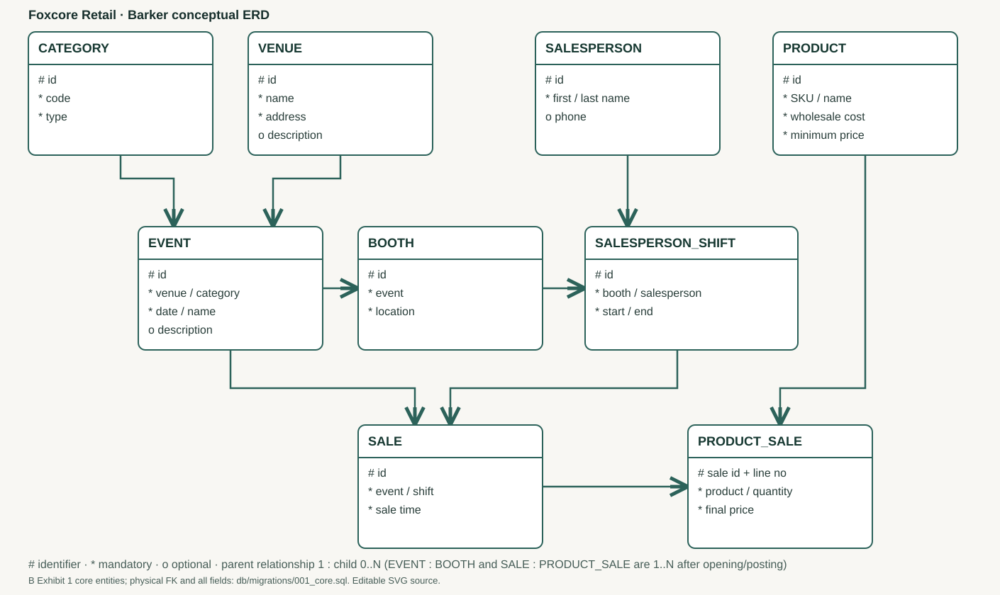

<!-- foxcore-fixes-current -->
> 本轮修复：实现与验证状态以 [修复说明](fixes/README.md)、[决策](fixes/decisions.md)、[验证记录](fixes/verification.md) 和 `use-cases.json` 为准。下文未更新的历史运行统计不代表本轮通过。PDF/既有图片是旧基线派生物，尚未重新生成；修复后以 Markdown、源码及新合同为准。
<!-- /foxcore-fixes-current -->

# 04 数据库设计与 ERD

**Foxcore Retail — 数据库设计说明（概念 / 逻辑 / 物理三层）**

---

## 文档信息

| 项目 | 内容 |
|---|---|
| 文档名称 | Foxcore Retail 数据库设计说明（Database Design Description） |
| 文档编号 | FC-DBD-001 |
| 版本 | 1.1 |
| 状态 | 基线发布（Baselined） |
| 编制日期 | 2026-09-27 |
| 目标 DBMS | MariaDB 11.8 / InnoDB（本地）；云端为 MySQL 兼容的 TiDB Cloud Starter |
| 上游文档 | [01 愿景与业务建模](01-vision-business.md)、[02 SRS](02-SRS.md)、[03 SDD](03-SDD.md) |
| 下游文档 | [05 STD](05-STD.md)（不变量与数据测试）、[07 部署运维](07-deployment-local.md)（迁移与备份） |
| 概念基线 | Foxcore Retail A 第 3 页（六类信息）、Foxcore Retail B 第 3 页 Exhibit 1（九核心实体） |

## 修订历史

| 版本 | 日期 | 修订人 | 修订说明 |
|---|---|---|---|
| 0.1 | 2026-09-20 | 项目组 | 概念模型（Barker）与九核心实体映射 |
| 0.9 | 2026-09-25 | 项目组 | 24 张物理表、索引、CHECK 与外键、不变量脚本 |
| 1.0 | 2026-09-27 | 项目组 | 迁移校验和与备份恢复策略定稿 |
| 1.1 | 2026-09-27 | 项目组 | 按概念→逻辑→物理三层重写：分模块概念设计、全局/逻辑 ERD、24 表完整数据字典、归一化推导、SQL 实现示例 |

## 目录

1. [引言](#1-引言)
2. [概念数据库设计](#2-概念数据库设计)
3. [逻辑数据库设计](#3-逻辑数据库设计)
4. [物理数据库设计](#4-物理数据库设计)
5. [数据完整性与不变量](#5-数据完整性与不变量)
6. [迁移、种子数据与恢复](#6-迁移种子数据与恢复)
7. [可追踪性](#7-可追踪性)
8. [附录：SQL 实现示例](#附录sql-实现示例)

---

## 1 引言

### 1.1 目的

本文档给出 Foxcore Retail 数据库的**完整设计说明**，覆盖从概念模型到可执行 DDL 的全过程，用于：

1. 说明课程案例 A/B 的概念模型如何映射为可实现的物理模式；
2. 给出每一张表、每一个字段、每一个约束的权威定义（数据字典）；
3. 论证模式满足第三范式（3NF）并说明有意的冗余取舍；
4. 定义数据完整性断言（不变量）及其核查方式；
5. 规定迁移、种子数据与备份恢复的规程。

### 1.2 范围

- 概念层：按业务模块的局部 ERD 与全局概念 ERD（Barker 记号）；
- 逻辑层：逻辑 ERD、逻辑数据字典、关系模式、归一化推导；
- 物理层：24 张表的完整定义、索引策略、约束清单、种子数据；
- 完整性：16 项不变量与核查脚本；
- 运维：迁移顺序、校验和、备份恢复。

不含：SQL 调优基准、分片与读写分离、跨时区与多币种扩展。

### 1.3 定义、缩写与记号

| 记号/术语 | 含义 |
|---|---|
| `#` | Barker 记号：**标识符**（唯一标识实体的属性） |
| `*` | Barker 记号：**强制**属性（必填） |
| `o` | Barker 记号：**可选**属性（可空） |
| **PK / FK / AK** | 主码 / 外码 / 候选码（Alternate Key） |
| **1 : N** | 一对多关系 |
| **弱实体** | 依赖父实体存在、主键部分或全部来自父实体的实体（如 `sale_lines`） |
| **3NF** | 第三范式：无传递函数依赖；本设计的目标范式 |
| **不变量** | 任意事务提交后必须为真的断言，由 `db/check-invariants.sql` 核查 |
| **快照列** | 成交时冻结的主数据副本，用于保证历史口径 |
| **bps** | basis point，万分之一（税率、佣金率的存储单位） |

### 1.4 参考文献

| 编号 | 文献 | 用途 |
|---|---|---|
| REF-01 | Foxcore Retail A — Designing a Database | 概念基线：六类信息 |
| REF-02 | Foxcore Retail B — Database Implementation, Exhibit 1 | 物理基线：九核心实体 |
| REF-03 | [02 SRS](02-SRS.md) | 数据相关需求 |
| REF-04 | [03 SDD](03-SDD.md) | 数据设计原则 |
| REF-05 | `db/migrations/001_core.sql` | 权威 DDL |
| REF-06 | `db/check-invariants.sql` | 不变量核查 |

### 1.5 概述：现有系统 vs 拟议系统

| 维度 | 现有（AS-IS） | 拟议（TO-BE） |
|---|---|---|
| 数据载体 | 纸质交接表、Excel 台账、事后汇总 | 单一关系数据库，事务化写入 |
| 库存可见性 | 事后盘点才知道差额 | 实时余额 + 只增流水，随时重算 |
| 价格口径 | 现场口头议价，无底价校验 | 商品底价快照 + 服务端复核 |
| 成交归属 | 手写班次，难以定位责任班次 | 销售强制绑定 `(shift_id, event_id)` 复合外键 |
| 退货 | 无冲回记录，佣金照提 | 退货行按原单分摊税佣，生成负向佣金 |
| 追溯 | 无法回答"谁在何时改了什么" | `audit_events` 与业务同事务写入 |

---

## 2 概念数据库设计

概念模型以 **Barker 记号**表达，完整图见 [`diagrams/core-barker.svg`](diagrams/core-barker.svg)。



**图 2-0 全局概念 ERD（Barker 记号）**

### 2.1 课程案例基线与映射

案例 A 列出六类信息（Venue、Event、Booth、Product、Salesperson、Sale 相关），案例 B 的 Exhibit 1 给出**九个核心实体**：CATEGORY、VENUE、EVENT、BOOTH、PRODUCT、SALESPERSON、SALESPERSON_SHIFT、SALE、PRODUCT_SALE。**"六类信息"不等于"只能建六张表"**——A 的六类是信息分类，B 的九实体是实体级基线，运行所需的身份、库存、退货、佣金、审计等属于在九实体之上的**运行扩展（EXT）**。

| B 实体 | 物理表 | 主键 | 关键关系 | 说明 |
|---|---|---|---|---|
| CATEGORY | `event_categories` | `id` | 1:N → `events` | 七类原文类别作种子；`code`/`type` 均唯一 |
| VENUE | `venues` | `id` | 1:N → `events` | B 图拆分地址为 Street/City/Province/PCode；A 的完整地址由界面组合显示 |
| EVENT | `events` | `id` | FK `venue_id`,`category_id`；1:N → `booths`,`shifts`,`sales` | 活动日期、状态、`tax_bps`、政策确认为运行补充 |
| BOOTH | `booths` | `id` | FK `event_id`；UNIQUE(`event_id`,`location`) | 开放活动前至少存在一个有效展位 |
| PRODUCT | `products` | `id` | 1:N → `sale_lines`,`stock_balances` | `sku` 唯一；保留成本与底价 |
| SALESPERSON | `salespeople` | `id` | 1:N → `shifts`,`users`,`commission_entries` | A 中的电话保留且可空；B 图未列电话不代表删除 |
| SALESPERSON_SHIFT | `shifts` | `id` | 复合 FK `(booth_id,event_id)`；UNIQUE(`id`,`event_id`) | 一班一展位；一名员工可有多班 |
| SALE | `sales` | `id` | 复合 FK `(shift_id,event_id)` | 保留 B 的 SALE→EVENT 与 SALE→SHIFT **双关联** |
| PRODUCT_SALE | `sale_lines` | PK(`sale_id`,`line_no`) | FK `product_id` | B 原有 Line_No、Quantity、Final_Price；本系统**额外冻结快照** |

**概念关系骨架：**

```text
CATEGORY   1─────N  EVENT  N─────1  VENUE
EVENT      1─────N  BOOTH  1─────N  SALESPERSON_SHIFT  N─────1  SALESPERSON
SALESPERSON_SHIFT 1──N  SALE ；      EVENT  1──N  SALE
SALE       1─────N  PRODUCT_SALE  N─────1  PRODUCT
```

### 2.2 分模块概念设计

按 KADA 概念设计文档的惯例，逐模块给出：模块描述 → 事务需求（录入 / 更新删除 / 查询）→ 局部概念 ERD。

#### 2.2.1 模块 1：身份认证（Authentication）

**模块描述**：为业主管理员与现场销售员提供账号、口令与会话管理；销售员账号与员工档案一一对应。

**事务需求**

| 类型 | 需求 |
|---|---|
| 数据录入 | 创建角色账号（OWNER / SALESPERSON）；登录生成会话；改密 |
| 更新/删除 | 修改口令；启用/停用账号（不物理删除）；登出撤销会话 |
| 查询 | 当前登录者 `/auth/me`；账号列表；审计日志 |

**局部概念 ERD**

```text
SALESPERSON 1─────1  USER  1─────N  SESSION
                       │
                       └─────N  AUDIT_EVENT
```

#### 2.2.2 模块 2：主数据（Master Data）

**模块描述**：维护场地、活动类别、活动、展位、商品、员工档案及其排班。

**事务需求**

| 类型 | 需求 |
|---|---|
| 数据录入 | 场地（含拆分地址）；活动（日期、类别、税率、政策确认）；展位；商品（SKU、成本、底价、建议价）；员工（姓名、地址、电话、佣金率）；班次（展位、员工、业务日期、计划时段） |
| 更新/删除 | 商品价格与成本 `PATCH`；停用而非删除；活动开放/关闭/取消；班次开班/收班/取消 |
| 查询 | 各类列表（分页 20）；按活动查展位与班次；按员工与日期查班次 |

**局部概念 ERD**

```text
CATEGORY 1──N EVENT N──1 VENUE
EVENT 1──N BOOTH 1──N SHIFT N──1 SALESPERSON
```

#### 2.2.3 模块 3：库存（Inventory）

**模块描述**：管理主仓与展位两类库位、库内单据（收货/调拨/盘点/退货）、余额缓存与权威流水，以及待收款占用。

**事务需求**

| 类型 | 需求 |
|---|---|
| 数据录入 | 创建收货单（供应商→主仓）、调拨单（主仓→展位）、盘点单（差额调整） |
| 更新/删除 | **确认**调拨（实物交接后）；**不删除**任何流水或单据；占用状态 ACTIVE→CONSUMED/RELEASED |
| 查询 | 库位列表与余额；按库位+商品的流水明细；单据详情；可售量 = on_hand − reserved |

**局部概念 ERD**

```text
LOCATION(WAREHOUSE|BOOTH) 1──N STOCK_BALANCE N──1 PRODUCT
LOCATION 1──N STOCK_DOCUMENT 1──N STOCK_DOCUMENT_LINE N──1 PRODUCT
LOCATION 1──N STOCK_LEDGER N──1 PRODUCT
SALE_LINE 1──1 STOCK_HOLD N──1 LOCATION
```

关键概念约束：`on_hand ≥ reserved`；`STOCK_LEDGER` 只增不改（`delta ≠ 0`）；`STOCK_BALANCE` 可由流水重算。

#### 2.2.4 模块 4：销售（Sales）

**模块描述**：现场录单、占用库存、线下收款确认与过账；成交行冻结全部价格与费率快照。

**事务需求**

| 类型 | 需求 |
|---|---|
| 数据录入 | 创建销售草稿（班次、明细行、商定单价）；准备收款（复核并占用）；过账（登记收款确认） |
| 更新/删除 | 草稿可改可取消；CHECKOUT 状态取消须先确认款项与商品去向；**已 POSTED 不可改，须走退货** |
| 查询 | 单据分页（销售列表默认 100/页，上限 100）；按班次/活动/日期过滤；上一页/下一页 |

**局部概念 ERD**

```text
SHIFT 1──N SALE 1──N SALE_LINE N──1 PRODUCT
SALE_LINE 1──1 STOCK_HOLD
SALE_LINE 1──1 COMMISSION_ENTRY
```

#### 2.2.5 模块 5：退货（Returns）

**模块描述**：对已过账单据做部分或整单退货，分摊原税佣，区分良品回库与损坏品。

**事务需求**

| 类型 | 需求 |
|---|---|
| 数据录入 | 选择原单与原行；登记退货数量、处置方式（RESTOCK/DAMAGED）、理由 |
| 更新/删除 | 授权 → 过账；未过账可取消；**不物理删除**退货记录 |
| 查询 | 退货单详情；按原单查累计退货 |

关键概念约束：累计退货数量 ≤ 原销量；一行在同一退货单中只能出现一次。

#### 2.2.6 模块 6：佣金（Commissions）

**模块描述**：按销售行计提正向佣金、按退货行计提负向冲回；按员工结算并占用未结流水。

**事务需求**

| 类型 | 需求 |
|---|---|
| 数据录入 | 过账/退货自动生成计提条目；创建结算（锁定员工全部未结条目） |
| 更新/删除 | 结算登记支付；未支付可取消并释放占用；**条目本身不更新不删除** |
| 查询 | 按员工查计提明细；结算列表与明细 |

关键概念约束：**一笔计提条目只能被一个结算占用**（`commission_claims` 以 `entry_id` 为主键）。

#### 2.2.7 模块 7：平台服务（Platform）

**模块描述**：幂等键、审计事件、迁移校验和。

```text
USER 1──N IDEMPOTENCY_KEY
USER 1──N AUDIT_EVENT
```

---

## 3 逻辑数据库设计

### 3.1 逻辑 ERD

逻辑模型即把概念模型中的多对多（ PRODUCT_SALE / STOCK 关联 ）解析为关联实体，并为所有关系确定可选性与基数。渲染件见 [`diagrams/physical-erd.svg`](diagrams/physical-erd.svg)（物理层同时表达逻辑结构）；逻辑关系的文字化表达见 §3.3 关系模式。

### 3.2 逻辑数据字典（实体级）

| 实体 | 标识符（`#`） | 强制属性（`*`） | 可选属性（`o`） | 基数要点 |
|---|---|---|---|---|
| CATEGORY | `id` | `code`, `type` | — | 1:N → EVENT |
| VENUE | `id` | `name`, `street`, `city`, `province`, `postal_code` | `description` | 1:N → EVENT |
| EVENT | `id` | `venue_id`, `category_id`, `name`, `start_date`, `end_date`, `status` | `tax_bps`, `description` | 1:N → BOOTH / SHIFT / SALE |
| BOOTH | `id` | `event_id`, `location` | — | 1:N → SHIFT；1:1 → LOCATION(BOOTH) |
| PRODUCT | `id` | `sku`, `name`, `wholesale_cost_cents`, `min_price_cents` | `suggested_price_cents` | 1:N → SALE_LINE / BALANCE |
| SALESPERSON | `id` | `first_name`, `last_name` | `street`,`city`,`province`,`postal_code`,`phone`,`commission_bps` | 1:N → SHIFT / USER / COMMISSION |
| SHIFT | `id` | `salesperson_id`, `booth_id`, `event_id`, `business_date`, `planned_start`, `planned_end`, `status` | `actual_start`, `actual_end` | 1:N → SALE |
| USER | `id` | `username`, `password_hash`, `role`, `active` | `salesperson_id`, `locked_until` | 1:N → SESSION |
| SESSION | `id` | `user_id`, `token_hash`, `csrf_hash`, `expires_at` | `revoked_at` | N:1 → USER |
| SALE | `id` | `shift_id`, `event_id`, `state`, `created_by` | `sale_no`, `posted_by`, `payment_method`, `payment_reference`, `cash_received_cents` | 1:N → SALE_LINE |
| SALE_LINE | `sale_id`+`line_no` | `product_id`, `quantity`, `final_unit_price_cents` | 全部快照列 | 弱实体 |
| LOCATION | `id` | `code`, `name`, `kind` | `booth_id` | 1:N → BALANCE / LEDGER |
| STOCK_BALANCE | `location_id`+`product_id` | `on_hand`, `reserved` | — | 关联实体 |
| STOCK_DOCUMENT | `id` | `kind`, `reason`, `created_by` | `from_location_id`, `to_location_id` | 1:N → LINE |
| STOCK_DOCUMENT_LINE | `document_id`+`line_no` | `product_id`, `quantity` | — | 弱实体 |
| STOCK_LEDGER | `id` | `location_id`, `product_id`, `delta`, `source_kind`, `source_id`, `source_line_no` | — | 只增 |
| STOCK_HOLD | `sale_id`+`line_no` | `location_id`, `product_id`, `quantity`, `status` | — | 弱实体 |
| RETURN | `id` | `sale_id`, `state`, `reason`, `created_by` | `refund_reference`, `destination_location_id` | 1:N → RETURN_LINE |
| RETURN_LINE | `return_id`+`line_no` | `sale_line_no`, `quantity`, `disposition` | — | 弱实体 |
| COMMISSION_ENTRY | `id` | `salesperson_id`, `amount_cents`, `source_kind`, `source_id`, `source_line_no` | — | 只增 |
| COMMISSION_SETTLEMENT | `id` | `salesperson_id`, `state`, `cutoff_at`, `total_cents`, `created_by` | `payment_reference`, `paid_at` | 1:N → LINE / CLAIM |
| COMMISSION_SETTLEMENT_LINE | `settlement_id`+`entry_id` | `amount_cents` | — | 关联实体 |
| COMMISSION_CLAIM | `entry_id` | `settlement_id` | — | 1:1 占用 |
| IDEMPOTENCY_KEY | `actor_id`+`operation`+`command_key` | `request_hash`, `response_json` | — | 去重 |
| AUDIT_EVENT | `id` | `action`, `subject_type` | `actor_id`, `subject_id`, `detail_json` | 追加 |

### 3.3 关系模式（Relational Schema）

下划线为主码，`(FK)` 标外码，`(UQ)` 标唯一。

```text
event_categories         (id, code(UQ), type(UQ))
venues                   (id, name, street, city, province, postal_code, description, active, version)
events                   (id, venue_id(FK), category_id(FK), name, start_date, end_date,
                          description, status, timezone, tax_bps, policy_confirmed, version)
booths                   (id, event_id(FK), location, active,
                          UQ(event_id,location), UQ(id,event_id))
products                 (id, sku(UQ), name, wholesale_cost_cents, min_price_cents,
                          suggested_price_cents, active, version)
salespeople              (id, first_name, last_name, street, city, province, postal_code,
                          phone, description, active, commission_bps, version)
shifts                   (id, salesperson_id(FK), booth_id(FK), event_id(FK), business_date,
                          planned_start, planned_end, actual_start, actual_end, status, version,
                          UQ(id,event_id))
users                    (id, username(UQ), password_hash, role, salesperson_id(FK,UQ), active,
                          must_change_password, failed_logins, locked_until, created_at)
sessions                 (id, user_id(FK), token_hash(UQ), csrf_hash, created_at,
                          last_seen_at, expires_at, revoked_at)
sales                    (id, sale_no(UQ), shift_id(FK), event_id(FK), state, created_at,
                          prepared_at, posted_at, created_by(FK), posted_by(FK), payment_method,
                          payment_reference, cash_received_cents, net_cents, tax_cents,
                          total_cents, version, 复合FK(shift_id,event_id)→shifts(id,event_id))
sale_lines               (sale_id(FK), line_no, product_id(FK), quantity,
                          final_unit_price_cents, line_net_cents, line_tax_cents,
                          line_commission_cents, cost_snapshot_cents, min_snapshot_cents,
                          tax_bps_snapshot, commission_bps_snapshot, name_snapshot, sku_snapshot)
stock_locations          (id, code(UQ), name, kind, booth_id(FK,UQ), active)
stock_balances           (location_id(FK), product_id(FK), on_hand, reserved, version)
stock_documents          (id, kind, from_location_id(FK), to_location_id(FK), reason,
                          created_by(FK), created_at)
stock_document_lines     (document_id(FK), line_no, product_id(FK), quantity)
stock_ledger             (id, location_id(FK), product_id(FK), delta, source_kind, source_id,
                          source_line_no, created_at, UQ(source_kind,source_id,source_line_no,location_id))
stock_holds              (sale_id(FK), line_no(FK), location_id(FK), product_id(FK), quantity, status)
returns                  (id, sale_id(FK), state, reason, refund_reference,
                          destination_location_id(FK), created_by(FK), authorized_at, posted_at,
                          net_cents, tax_cents, total_cents, created_at)
return_lines             (return_id(FK), line_no, sale_line_no, quantity, disposition,
                          net_cents, tax_cents, commission_cents, UQ(return_id,sale_line_no))
commission_entries       (id, salesperson_id(FK), amount_cents, source_kind, source_id,
                          source_line_no, created_at, UQ(source_kind,source_id,source_line_no))
commission_settlements   (id, salesperson_id(FK), state, cutoff_at, total_cents,
                          payment_reference, created_by(FK), created_at, paid_at)
commission_settlement_lines (settlement_id(FK), entry_id(FK), amount_cents)
commission_claims        (entry_id(FK) PK, settlement_id(FK))
idempotency_keys         (actor_id(FK), operation, command_key, request_hash, response_json, created_at)
audit_events             (id, actor_id(FK), action, subject_type, subject_id, detail_json, created_at)
schema_migrations        (version, checksum_sha256, applied_at)
```

**复合外键链（归属不可篡改）**

```text
booths  UQ(id, event_id)  ──>  shifts(booth_id, event_id)
shifts  UQ(id, event_id)  ──>  sales (shift_id, event_id)
```

该链使"把一笔销售改挂到另一活动"或"把班次改挂到另一活动的展位"在数据库层即被拒绝，无需依赖应用层校验。

### 3.4 归一化

**目标：3NF。** 逐范式论证：

| 范式 | 论证 |
|---|---|
| **1NF** | 所有列均为原子标量；无重复组。多值明细（销售明细、单据明细、退货明细）建模为独立弱实体，而非逗号拼接字段 |
| **2NF** | 所有弱实体的非主属性完全依赖于**整个**复合主码：`sale_lines` 的数量与价格依赖 `(sale_id,line_no)`；`stock_balances` 的 `on_hand`/`reserved` 依赖 `(location_id,product_id)`。不存在仅依赖部分主码的属性 |
| **3NF** | 消除传递依赖：`venues` 的地址只依赖 `venues.id`；`sales` 不冗余保存 `venue_id`（由 `event_id` 可达）；`products` 的名称不复制到 `sale_lines` 的**可编辑**字段中——名称只作为 `name_snapshot` 存在于历史行 |

**有意保留的冗余（已记录，非范式违规）**

| 冗余 | 理由 | 一致性保障 |
|---|---|---|
| `sale_lines` 的 7 个快照列（单价、名称、SKU、成本、底价、税率、佣金率） | **历史口径冻结**：主数据后续变更不得改变已成交单据的金额与佣金解释（ADR-03） | 快照在过账时一次性写入，之后只读 |
| `stock_balances`（`on_hand`, `reserved`） | **性能**：避免每次可售量查询都聚合全表流水 | 不变量 I-02/I-04 核查"余额 = 流水汇总"，可随时重算 |
| `sales` 的 `net_cents`/`tax_cents`/`total_cents` | 单据级合计便于列表与报表直接读取 | 不变量 I-06 核查"合计 = 明细汇总" |
| `commission_settlements.total_cents` | 结算单总额 | 不变量 I-16 核查与明细一致 |

以上冗余均为**可由权威数据重算的派生值**，且每项都有对应的不变量核查，因此不构成更新异常风险。

---

## 4 物理数据库设计

### 4.1 物理 ERD


**图 4-1 物理 ERD（24 张表 + `schema_migrations`）**（源：`diagrams/physical-erd.puml`）

**存储引擎**：全部 InnoDB（事务、行锁、外键、CHECK 支持）。
**字符集**：`utf8mb4`。
**金额**：一律 `BIGINT`（分），带符号列用于可正可负的流水（`delta`、`amount_cents`）。

### 4.2 物理数据字典

> 记号：**PK** 主码 / **FK** 外码 / **UQ** 唯一 / **CK** 检查约束 / **NN** 非空。

#### 4.2.1 主数据（7 张）

**`event_categories`** — 活动类别（种子表）

| 列 | 类型 | 空 | 键 | 说明 |
|---|---|:--:|---|---|
| `id` | BIGINT UNSIGNED | NN | PK | 自增 |
| `code` | VARCHAR(40) | NN | UQ | 机器可读代码，如 `trade_show` |
| `type` | VARCHAR(80) | NN | UQ | 展示名，如 `trade show` |

**`venues`** — 场地

| 列 | 类型 | 空 | 键 | 说明 |
|---|---|:--:|---|---|
| `id` | BIGINT UNSIGNED | NN | PK | |
| `name` | VARCHAR(120) | NN | | 场地名 |
| `street` / `city` / `province` | VARCHAR(120/80/80) | NN | | A 图拆分地址的三部分 |
| `postal_code` | VARCHAR(16) | NN | | 邮编 |
| `description` | VARCHAR(500) | √ | | 备注 |
| `active` | BOOLEAN | NN | | 默认 TRUE，停用而非删除 |
| `version` | INT UNSIGNED | NN | | 乐观并发版本，默认 1 |

**`events`** — 活动

| 列 | 类型 | 空 | 键 | 说明 |
|---|---|:--:|---|---|
| `id` | BIGINT UNSIGNED | NN | PK | |
| `venue_id` | BIGINT UNSIGNED | NN | FK→`venues` | |
| `category_id` | BIGINT UNSIGNED | NN | FK→`event_categories` | |
| `name` | VARCHAR(120) | NN | | |
| `start_date` / `end_date` | DATE | NN | CK | `end_date >= start_date` |
| `description` | VARCHAR(500) | √ | | |
| `status` | ENUM(DRAFT,OPEN,CLOSED,CANCELLED) | NN | | 默认 DRAFT |
| `timezone` | VARCHAR(64) | NN | | 默认 `America/Toronto` |
| `tax_bps` | SMALLINT UNSIGNED | √ | CK | 税率（万分比），`<= 10000` |
| `policy_confirmed` | BOOLEAN | NN | | 管理员确认税率与政策 |
| `version` | INT UNSIGNED | NN | | 默认 1 |

**`booths`** — 展位

| 列 | 类型 | 空 | 键 | 说明 |
|---|---|:--:|---|---|
| `id` | BIGINT UNSIGNED | NN | PK | |
| `event_id` | BIGINT UNSIGNED | NN | FK→`events` | |
| `location` | VARCHAR(80) | NN | UQ(event_id,location) | 同一活动下位置唯一 |
| `active` | BOOLEAN | NN | | 默认 TRUE |
| — | — | — | UQ(id,event_id) | **复合外键链起点** |

**`products`** — 商品

| 列 | 类型 | 空 | 键 | 说明 |
|---|---|:--:|---|---|
| `id` | BIGINT UNSIGNED | NN | PK | |
| `sku` | VARCHAR(64) | NN | UQ | 库存单位编码 |
| `name` | VARCHAR(160) | NN | | |
| `wholesale_cost_cents` | BIGINT UNSIGNED | NN | | 批发成本（分）——**销售员不可见** |
| `min_price_cents` | BIGINT UNSIGNED | NN | | 最低成交价（分），准备收款时复核 |
| `suggested_price_cents` | BIGINT UNSIGNED | √ | CK | 建议价，`>= min_price_cents` |
| `active` | BOOLEAN | NN | | |
| `version` | INT UNSIGNED | NN | | |

**`salespeople`** — 员工档案

| 列 | 类型 | 空 | 键 | 说明 |
|---|---|:--:|---|---|
| `id` | BIGINT UNSIGNED | NN | PK | |
| `first_name` / `last_name` | VARCHAR(80) | NN | | |
| `street` / `city` / `province` / `postal_code` | VARCHAR | √ | | 可选住址（A 图保留） |
| `phone` | VARCHAR(32) | √ | | A 图保留，可空 |
| `description` | VARCHAR(500) | √ | | |
| `active` | BOOLEAN | NN | | |
| `commission_bps` | SMALLINT UNSIGNED | √ | CK | 默认佣金率，`<= 10000` |
| `version` | INT UNSIGNED | NN | | |

**`shifts`** — 班次（SALESPERSON_SHIFT）

| 列 | 类型 | 空 | 键 | 说明 |
|---|---|:--:|---|---|
| `id` | BIGINT UNSIGNED | NN | PK | |
| `salesperson_id` | BIGINT UNSIGNED | NN | FK→`salespeople` | |
| `booth_id` | BIGINT UNSIGNED | NN | 复合FK→`booths(id,event_id)` | 一班一展位 |
| `event_id` | BIGINT UNSIGNED | NN | 同上 | |
| `business_date` | DATE | NN | | 业务日期（多伦多时区） |
| `planned_start` / `planned_end` | DATETIME(3) | NN | CK | `planned_end > planned_start` |
| `actual_start` / `actual_end` | DATETIME(3) | √ | | 实际开班/收班 |
| `status` | ENUM(PLANNED,ACTIVE,CLOSED,CANCELLED) | NN | | 默认 PLANNED |
| `version` | INT UNSIGNED | NN | | |
| — | — | — | UQ(id,event_id) / IX(salesperson_id,business_date) | 复合外键链 + 常用查询索引 |

#### 4.2.2 身份与会话（2 张）

**`users`**

| 列 | 类型 | 空 | 键 | 说明 |
|---|---|:--:|---|---|
| `id` | BIGINT UNSIGNED | NN | PK | |
| `username` | VARCHAR(80) | NN | UQ | |
| `password_hash` | VARCHAR(255) | NN | | Argon2id 散列，**永不存明文** |
| `role` | ENUM(OWNER,SALESPERSON) | NN | | |
| `salesperson_id` | BIGINT UNSIGNED | √ | FK→`salespeople`, UQ | 销售员账号与档案一一对应 |
| `active` | BOOLEAN | NN | | 默认 TRUE |
| `must_change_password` | BOOLEAN | NN | | 首次登录强制改密 |
| `failed_logins` | INT UNSIGNED | NN | | 失败计数，默认 0 |
| `locked_until` | DATETIME(3) | √ | | 锁定时点 |
| `created_at` | DATETIME(3) | NN | | 默认当前时间(3) |
| — | — | — | CK | `(role='OWNER' AND salesperson_id IS NULL) OR (role='SALESPERSON' AND salesperson_id IS NOT NULL)` |

**`sessions`**

| 列 | 类型 | 空 | 键 | 说明 |
|---|---|:--:|---|---|
| `id` | BIGINT UNSIGNED | NN | PK | |
| `user_id` | BIGINT UNSIGNED | NN | FK→`users` | |
| `token_hash` | CHAR(64) | NN | UQ | 会话令牌的 **SHA-256 摘要**（不存令牌本身） |
| `csrf_hash` | CHAR(64) | NN | | CSRF 双重提交摘要 |
| `created_at` / `last_seen_at` | DATETIME(3) | NN | | 创建与最近活跃（空闲 30 分钟过期） |
| `expires_at` | DATETIME(3) | NN | | 绝对过期（12 小时） |
| `revoked_at` | DATETIME(3) | √ | | 主动撤销（登出/改密/停用） |

#### 4.2.3 交易（2 张）

**`sales`**

| 列 | 类型 | 空 | 键 | 说明 |
|---|---|:--:|---|---|
| `id` | BIGINT UNSIGNED | NN | PK | |
| `sale_no` | VARCHAR(40) | √ | UQ | 业务单号（过账时生成） |
| `shift_id` / `event_id` | BIGINT UNSIGNED | NN | 复合FK→`shifts(id,event_id)` | **双关联，归属不可篡改** |
| `state` | ENUM(DRAFT,CHECKOUT,POSTED,CANCELLED) | NN | | 默认 DRAFT |
| `created_at` / `prepared_at` / `posted_at` | DATETIME(3) | √/NN | | 创建、准备收款、过账时点 |
| `created_by` | BIGINT UNSIGNED | NN | FK→`users` | |
| `posted_by` | BIGINT UNSIGNED | √ | FK→`users` | |
| `payment_method` | ENUM(CASH,TERMINAL) | √ | | 线下收款方式 |
| `payment_reference` | VARCHAR(120) | √ | | 终端参考号 |
| `cash_received_cents` | BIGINT UNSIGNED | √ | | 现金实收（分） |
| `net_cents` / `tax_cents` / `total_cents` | BIGINT UNSIGNED | NN | | 合计（分），默认 0 |
| `version` | INT UNSIGNED | NN | | 默认 1 |
| — | — | — | IX | `(event_id,posted_at)`、`(shift_id,posted_at)` 供报表扫描 |

**`sale_lines`**（弱实体）

| 列 | 类型 | 空 | 键 | 说明 |
|---|---|:--:|---|---|
| `sale_id` | BIGINT UNSIGNED | NN | PK, FK→`sales` | |
| `line_no` | SMALLINT UNSIGNED | NN | PK | 行号 |
| `product_id` | BIGINT UNSIGNED | NN | FK→`products` | |
| `quantity` | INT UNSIGNED | NN | CK | `BETWEEN 1 AND 9999` |
| `final_unit_price_cents` | BIGINT UNSIGNED | NN | | 成交单价（分） |
| `line_net_cents` / `line_tax_cents` | BIGINT UNSIGNED | NN | | 行净额/税额 |
| `line_commission_cents` | BIGINT UNSIGNED | NN | | 行佣金 |
| `cost_snapshot_cents` | BIGINT UNSIGNED | √ | | **成本快照** |
| `min_snapshot_cents` | BIGINT UNSIGNED | √ | | **底价快照** |
| `tax_bps_snapshot` / `commission_bps_snapshot` | SMALLINT UNSIGNED | √ | | **费率快照** |
| `name_snapshot` / `sku_snapshot` | VARCHAR(160/64) | √ | | **名称与 SKU 快照** |
| — | — | — | IX | `(product_id,sale_id)` |

#### 4.2.4 库存（6 张）

**`stock_locations`**

| 列 | 类型 | 空 | 键 | 说明 |
|---|---|:--:|---|---|
| `id` | BIGINT UNSIGNED | NN | PK | |
| `code` | VARCHAR(80) | NN | UQ | 如 `MAIN` |
| `name` | VARCHAR(120) | NN | | 如 `主仓` |
| `kind` | ENUM(WAREHOUSE,BOOTH) | NN | | |
| `booth_id` | BIGINT UNSIGNED | √ | FK→`booths`, UQ | 展位库位必关联展位 |
| `active` | BOOLEAN | NN | | |
| — | — | — | CK | `(kind='WAREHOUSE' AND booth_id IS NULL) OR (kind='BOOTH' AND booth_id IS NOT NULL)` |

**`stock_balances`**（可重算缓存）

| 列 | 类型 | 空 | 键 | 说明 |
|---|---|:--:|---|---|
| `location_id` | BIGINT UNSIGNED | NN | PK, FK→`stock_locations` | |
| `product_id` | BIGINT UNSIGNED | NN | PK, FK→`products` | |
| `on_hand` | BIGINT UNSIGNED | NN | | 在手量 |
| `reserved` | BIGINT UNSIGNED | NN | | 已占用量（可售 = on_hand − reserved） |
| `version` | INT UNSIGNED | NN | | 乐观并发 |
| — | — | — | CK | `on_hand >= reserved` |

**`stock_documents`**

| 列 | 类型 | 空 | 键 | 说明 |
|---|---|:--:|---|---|
| `id` | BIGINT UNSIGNED | NN | PK | |
| `kind` | ENUM(RECEIVE,TRANSFER,ADJUST,RETURN) | NN | | 单据类型 |
| `from_location_id` / `to_location_id` | BIGINT UNSIGNED | √ | FK→`stock_locations` | 收货只有 to；盘点按方向 |
| `reason` | VARCHAR(500) | NN | | **必填理由**，不可为空 |
| `created_by` | BIGINT UNSIGNED | NN | FK→`users` | |
| `created_at` | DATETIME(3) | NN | | |

**`stock_document_lines`**

| 列 | 类型 | 空 | 键 | 说明 |
|---|---|:--:|---|---|
| `document_id` / `line_no` | BIGINT / SMALLINT UNSIGNED | NN | PK | 复合主码 |
| `product_id` | BIGINT UNSIGNED | NN | FK→`products` | |
| `quantity` | INT | NN | CK | 带符号，`<> 0` |

**`stock_ledger`**（权威流水，只增不改）

| 列 | 类型 | 空 | 键 | 说明 |
|---|---|:--:|---|---|
| `id` | BIGINT UNSIGNED | NN | PK | |
| `location_id` / `product_id` | BIGINT UNSIGNED | NN | FK | |
| `delta` | BIGINT | NN | CK | 带符号增减，`<> 0` |
| `source_kind` | ENUM(DOCUMENT,SALE,RETURN) | NN | | 来源类型 |
| `source_id` / `source_line_no` | BIGINT / SMALLINT UNSIGNED | NN | | 来源定位 |
| `created_at` | DATETIME(3) | NN | | |
| — | — | — | UQ | `(source_kind, source_id, source_line_no, location_id)` —— **同一来源不重复入账** |
| — | — | — | IX | `(location_id, product_id)` |

**`stock_holds`**（待收款占用）

| 列 | 类型 | 空 | 键 | 说明 |
|---|---|:--:|---|---|
| `sale_id` + `line_no` | BIGINT / SMALLINT UNSIGNED | NN | PK, 复合FK→`sale_lines(sale_id,line_no)` | 与销售行一一对应 |
| `location_id` / `product_id` | BIGINT UNSIGNED | NN | FK | |
| `quantity` | INT UNSIGNED | NN | | |
| `status` | ENUM(ACTIVE,CONSUMED,RELEASED) | NN | | 默认 ACTIVE |

#### 4.2.5 退货（2 张）

**`returns`**

| 列 | 类型 | 空 | 键 | 说明 |
|---|---|:--:|---|---|
| `id` | BIGINT UNSIGNED | NN | PK | |
| `sale_id` | BIGINT UNSIGNED | NN | FK→`sales` | 原单 |
| `state` | ENUM(DRAFT,AUTHORIZED,POSTED,CANCELLED) | NN | | 默认 DRAFT |
| `reason` | VARCHAR(500) | NN | | 必填 |
| `refund_reference` | VARCHAR(120) | √ | | 线下退款参考号 |
| `destination_location_id` | BIGINT UNSIGNED | √ | FK→`stock_locations` | 良品回库目标 |
| `created_by` | BIGINT UNSIGNED | NN | FK→`users` | |
| `authorized_at` / `posted_at` | DATETIME(3) | √ | | |
| `net_cents` / `tax_cents` / `total_cents` | BIGINT UNSIGNED | NN | | 默认 0 |
| `created_at` | DATETIME(3) | NN | | |

**`return_lines`**

| 列 | 类型 | 空 | 键 | 说明 |
|---|---|:--:|---|---|
| `return_id` + `line_no` | BIGINT / SMALLINT UNSIGNED | NN | PK | |
| `sale_line_no` | SMALLINT UNSIGNED | NN | UQ(return_id,sale_line_no) | 同一退货单中一行只退一次 |
| `quantity` | INT UNSIGNED | NN | CK | `> 0` |
| `disposition` | ENUM(RESTOCK,DAMAGED) | NN | | 良品回库 / 损坏不入可售 |
| `net_cents` / `tax_cents` / `commission_cents` | BIGINT UNSIGNED | NN | | 按原单分摊 |

#### 4.2.6 佣金（4 张）

**`commission_entries`**（只增）

| 列 | 类型 | 空 | 键 | 说明 |
|---|---|:--:|---|---|
| `id` | BIGINT UNSIGNED | NN | PK | |
| `salesperson_id` | BIGINT UNSIGNED | NN | FK→`salespeople` | |
| `amount_cents` | BIGINT | NN | CK | 带符号（销售正、退货负），`<> 0` |
| `source_kind` | ENUM(SALE,RETURN) | NN | | |
| `source_id` / `source_line_no` | BIGINT / SMALLINT UNSIGNED | NN | UQ | 同一来源只计提一次 |
| `created_at` | DATETIME(3) | NN | IX(salesperson_id,created_at) | |

**`commission_settlements`**

| 列 | 类型 | 空 | 键 | 说明 |
|---|---|:--:|---|---|
| `id` | BIGINT UNSIGNED | NN | PK | |
| `salesperson_id` | BIGINT UNSIGNED | NN | FK→`salespeople` | |
| `state` | ENUM(PREPARED,PAID,CANCELLED) | NN | | 默认 PREPARED |
| `cutoff_at` | DATETIME(3) | NN | | 结算截止时点 |
| `total_cents` | BIGINT | NN | CK | `> 0` |
| `payment_reference` | VARCHAR(120) | √ | | 线下付款参考 |
| `created_by` | BIGINT UNSIGNED | NN | FK→`users` | |
| `created_at` / `paid_at` | DATETIME(3) | NN/√ | | |

**`commission_settlement_lines`**

| 列 | 类型 | 空 | 键 | 说明 |
|---|---|:--:|---|---|
| `settlement_id` / `entry_id` | BIGINT UNSIGNED | NN | PK, FK | 复合主码保证一条目不在同一结算中重复 |
| `amount_cents` | BIGINT | NN | | 该条目计入结算的金额 |

**`commission_claims`**（占用表）

| 列 | 类型 | 空 | 键 | 说明 |
|---|---|:--:|---|---|
| `entry_id` | BIGINT UNSIGNED | NN | **PK**, FK→`commission_entries` | **主键即保证一条目只能被一个结算占用** |
| `settlement_id` | BIGINT UNSIGNED | NN | FK→`commission_settlements` | |

#### 4.2.7 平台（3 张）

**`idempotency_keys`**

| 列 | 类型 | 空 | 键 | 说明 |
|---|---|:--:|---|---|
| `actor_id` / `operation` / `command_key` | BIGINT / VARCHAR(80) / CHAR(36) | NN | **PK** | 操作者+操作+UUID 键 |
| `request_hash` | CHAR(64) | NN | | 请求体摘要，不一致返回 409 |
| `response_json` | LONGTEXT | NN | | 首次响应，命中即原样返回 |
| `created_at` | DATETIME(3) | NN | | |

**`audit_events`**

| 列 | 类型 | 空 | 键 | 说明 |
|---|---|:--:|---|---|
| `id` | BIGINT UNSIGNED | NN | PK | |
| `actor_id` | BIGINT UNSIGNED | √ | FK→`users` | 空表示系统动作 |
| `action` | VARCHAR(100) | NN | | 如 `sale.post` |
| `subject_type` / `subject_id` | VARCHAR(60) / BIGINT | NN/√ | | 对象类型与标识 |
| `detail_json` | LONGTEXT | √ | | 明细快照 |
| `created_at` | DATETIME(3) | NN | IX | 按时间检索 |

**`schema_migrations`**

| 列 | 类型 | 空 | 键 | 说明 |
|---|---|:--:|---|---|
| `version` | VARCHAR | NN | PK | 迁移文件名（按序） |
| `checksum_sha256` | CHAR(64) | NN | | 文件内容校验和，变动即拒绝启动 |
| `applied_at` | DATETIME(3) | NN | | |

### 4.3 索引策略

| 类别 | 索引 | 目的 |
|---|---|---|
| 报表扫描 | `sales(event_id, posted_at)`、`sales(shift_id, posted_at)` | 按活动/班次汇总已过账销售 |
| 商品维度 | `sale_lines(product_id, sale_id)` | 按商品汇总 |
| 班次查询 | `shifts(salesperson_id, business_date)` | 员工日历视图 |
| 佣金查询 | `commission_entries(salesperson_id, created_at)` | 员工计提流水 |
| 审计查询 | `audit_events(created_at)` | 按时间倒序 |
| 库存查询 | `stock_ledger(location_id, product_id)` | 库位+商品流水 |
| 归属链 | `booths(id,event_id)`、`shifts(id,event_id)` | 复合外键的被引用端唯一键 |

**未建索引的列**：低基数的 `active`/`status` 单列索引未建（选择性差，收益低于写放大代价）；审计与流水表按时间范围查询已由主时间索引覆盖。

### 4.4 约束清单（CHECK / 业务规则下沉）

| 约束 | 表达式要点 | 保障的规则 |
|---|---|---|
| `ck_event_dates` | `end_date >= start_date` | 活动日期合法 |
| `ck_event_tax` | `tax_bps IS NULL OR <= 10000` | 税率不超过 100% |
| `ck_product_prices` | `suggested >= min` | 建议价不低于底价 |
| `ck_commission_rate` | `commission_bps IS NULL OR <= 10000` | 佣金率上限 |
| `ck_shift_times` | `planned_end > planned_start` | 班次时段合法 |
| `ck_user_salesperson_role` | 角色与档案绑定的异或 | OWNER 无档案、销售员必有档案 |
| `ck_line_qty` | `quantity BETWEEN 1 AND 9999` | 行数量合理 |
| `ck_balance_reserved` | `on_hand >= reserved` | **可售量非负** |
| `ck_docline_nonzero` | `quantity <> 0` | 单据行不为零 |
| `ck_ledger_nonzero` | `delta <> 0` | 流水不写空操作 |
| `ck_returnline_qty` | `quantity > 0` | 退货量为正 |
| `ck_commission_nonzero` | `amount_cents <> 0` | 计提不写零 |
| `ck_settlement_positive` | `total_cents > 0` | 结算金额为正 |
| `ck_location_kind` | 库位类型与展位绑定的异或 | 主仓不挂展位、展位库位必挂展位 |

**已成交业务引用的主数据不使用级联删除**：所有外键均为 `RESTRICT` 语义，防止删除场地/商品导致历史单据悬空。

---

## 5 数据完整性与不变量

不变量由 `db/check-invariants.sql` 实现，`npm run db:check` 执行；**任一差异非 0 即退出非 0**。当前基线：16 项全为 0。

| 编号 | 不变量 | 断言 |
|---|---|---|
| I-01 | 销售-班次活动一致 | `sales.event_id = shifts.event_id` |
| I-02 | 班次-展位活动一致 | `shifts.event_id = booths.event_id` |
| I-03 | 余额等于流水汇总 | `stock_balances.on_hand = SUM(stock_ledger.delta)` |
| I-04 | 流水必有余额 | 每条流水的 `(location,product)` 在余额表中存在 |
| I-05 | 占用等于有效 hold | `stock_balances.reserved = SUM(ACTIVE holds.quantity)` |
| I-06 | 可售量非负 | `on_hand >= reserved` |
| I-07 | 已过账销售金额一致 | `net/tax/total = 明细汇总，total = net + tax` |
| I-08 | 已过账销售必有库存流水 | 每条已过账销售行存在 `delta = −quantity` 的 SALE 流水 |
| I-09 | 已过账销售必有佣金 | 行佣金 > 0 时存在金额一致的 SALE 计提 |
| I-10 | 已过账退货金额一致 | `net/tax/total = 明细汇总` |
| I-11 | 退货不超原销量 | 累计退货数 ≤ 原行数量 |
| I-12 | 退货行指向真实原行 | `return_lines.sale_line_no` 在原单中存在 |
| I-13 | 已过账退货必有回库流水 | `RESTOCK` 行存在 `delta = quantity` 的 RETURN 流水 |
| I-14 | 已过账退货必有负佣金 | 退货佣金 > 0 时存在金额相反的 RETURN 计提 |
| I-15 | 取消结算无占用 | `CANCELLED` 结算在 `commission_claims` 中无记录 |
| I-16 | 结算金额一致 | `settlements.total_cents = SUM(settlement_lines.amount_cents)` |

**运行建议**：日常收档后执行一次；发现异常应立即停止新交易、备份当前卷并保留现场（见 [07 部署运维](07-deployment-local.md)）。

---

## 6 迁移、种子数据与恢复

### 6.1 迁移规程

| 规则 | 说明 |
|---|---|
| 顺序 | 按文件名升序执行（`001_core.sql` 之后按编号递增） |
| 校验和 | 每个文件应用后记录 SHA-256 到 `schema_migrations`；**已应用文件内容变动将拒绝启动** |
| 不可修改 | 已应用的迁移文件不得编辑；变更须**新增编号迁移** |
| 隐式提交 | MariaDB 的 DDL 会隐式提交，因此**不能靠单一事务回滚整份 DDL**；迁移前必须备份，失败即停止并修复或从受控备份恢复 |
| 执行者 | 本地由一次性 `migrate` 容器以管理员身份执行，随后收紧运行账号权限；云端由 `scripts/vercel-setup.mjs` 幂等执行 |
| 权限收紧 | 运行账号仅对必要表拥有 UPDATE/DELETE；**库存流水、佣金流水、审计表不授 UPDATE/DELETE** |

### 6.2 种子数据

| 种子 | 内容 | 来源 |
|---|---|---|
| 活动类别 | 7 类（trade show / rib fest / waterfront festival / music festival / beer festival / sporting event / street festival） | 随 `001_core.sql` 插入 |
| 主仓库位 | `MAIN / 主仓 / WAREHOUSE` | 随 `001_core.sql` 插入 |
| 首位管理员 | `owner` 账号 + 随机临时口令（≥32 字符） | 启动脚本生成，首次登录强制改密 |
| 样例业务数据 | 七类活动、17 名员工、30 个商品、300 笔已过账销售及取消/待收款/退货/已付佣金 | **独立**执行 `npm run seed:sample`，不随正常启动导入；**全部为合成教学数据** |

### 6.3 备份与恢复

- **备份窗口**：安排停写窗口后执行逻辑导出，文件仅留在受控本机磁盘并加密、限制访问；
- **恢复验证**：必须先在**独立空卷**验证（表数、单据数、16 项不变量），再制定正式恢复步骤；
- **持久化**：`db_data` 为命名卷，`docker compose down` 不删除数据；**禁止 `down -v`** 作为"修复"手段；
- **导出命令**见 [07 部署运维](07-deployment-local.md) 第 4 章（Windows 需注意重定向编码，建议用 `sh` 或二进制安全方式）。

---

## 7 可追踪性

### 7.1 案例实体 → 物理表

完整映射见 §2.1；追踪文件见 [`traceability.csv`](traceability.csv)（`CASE-01~12` 为案例要素，`DERIVED-*` 为派生设计，`EXT-*` 为运行扩展）。

### 7.2 需求 → 表

| 需求 | 主要表 |
|---|---|
| FR-01 认证 | `users`, `sessions` |
| FR-02/03 场地活动展位 | `venues`, `events`, `booths`, `event_categories` |
| FR-04 商品 | `products` |
| FR-05 员工班次 | `salespeople`, `shifts`, `users` |
| FR-06/07 库存 | `stock_locations`, `stock_documents`, `stock_document_lines`, `stock_balances`, `stock_ledger` |
| FR-08/09 销售 | `sales`, `sale_lines`, `stock_holds` |
| FR-10 退货 | `returns`, `return_lines` |
| FR-11 佣金 | `commission_entries`, `commission_settlements`, `commission_settlement_lines`, `commission_claims` |
| FR-12 报表 | 只读查询（上述表） |
| NFR-REL 幂等 | `idempotency_keys` |
| NFR-AUD 审计 | `audit_events` |

---

## 附录：SQL 实现示例

以下片段摘自权威 DDL `db/migrations/001_core.sql`，用于说明实现手法；**实际执行以迁移文件为准**。

### A.1 复合外键链（DDL）

```sql
CREATE TABLE booths (
  id BIGINT UNSIGNED NOT NULL AUTO_INCREMENT PRIMARY KEY,
  event_id BIGINT UNSIGNED NOT NULL,
  location VARCHAR(80) NOT NULL,
  active BOOLEAN NOT NULL DEFAULT TRUE,
  UNIQUE KEY uq_booth_event_location (event_id,location),
  UNIQUE KEY uq_booth_id_event (id,event_id),          -- 复合外键的被引用端
  CONSTRAINT fk_booths_event FOREIGN KEY (event_id) REFERENCES events(id)
) ENGINE=InnoDB;

CREATE TABLE shifts (
  ...
  UNIQUE KEY uq_shift_id_event (id,event_id),
  CONSTRAINT fk_shift_booth_event FOREIGN KEY (booth_id,event_id)
    REFERENCES booths(id,event_id),                     -- 展位与活动必须同源
  ...
) ENGINE=InnoDB;
```

### A.2 库存流水唯一性（防重复入账）

```sql
CONSTRAINT ... UNIQUE KEY uq_stock_source (source_kind,source_id,source_line_no,location_id)
```

同一来源（单据/销售/退货）的同一行在同一库位只能入账一次——这是"重试不产生重复流水"的数据库级保证。

### A.3 佣金占用（一笔条目只属一个结算）

```sql
CREATE TABLE commission_claims (
  entry_id BIGINT UNSIGNED NOT NULL PRIMARY KEY,        -- 主键即唯一占用
  settlement_id BIGINT UNSIGNED NOT NULL,
  CONSTRAINT fk_claim_entry FOREIGN KEY (entry_id) REFERENCES commission_entries(id),
  CONSTRAINT fk_claim_settlement FOREIGN KEY (settlement_id) REFERENCES commission_settlements(id)
) ENGINE=InnoDB;
```

### A.4 不变量核查（DML）

```sql
SELECT 'balance_ledger_difference' AS issue, COUNT(*) AS violations
FROM stock_balances b
LEFT JOIN (SELECT location_id,product_id,SUM(delta) AS quantity
           FROM stock_ledger GROUP BY location_id,product_id) l
  ON l.location_id=b.location_id AND l.product_id=b.product_id
WHERE b.on_hand <> COALESCE(l.quantity,0);
```

### A.5 事务骨架（应用层约定）

```sql
SET SESSION TRANSACTION ISOLATION LEVEL READ COMMITTED;
START TRANSACTION;
SELECT ... FROM idempotency_keys WHERE ... FOR UPDATE;   -- 1) 幂等行最先
SELECT ... FROM events         WHERE id=? FOR UPDATE;    -- 2) 活动
SELECT ... FROM shifts/sales   WHERE id=? FOR UPDATE;    -- 3) 班次与单据
SELECT ... FROM products       WHERE id=? FOR UPDATE;    -- 4) 商品（重读底价）
SELECT ... FROM stock_balances WHERE ...  FOR UPDATE;    -- 5) 余额最后
-- 业务写入 ...
COMMIT;
```

固定加锁顺序是避免死锁的关键。`db.ts` 的 `tx()` 在捕获 `ER_LOCK_DEADLOCK`（errno 1213）、`ER_LOCK_WAIT_TIMEOUT`（1205）与 `ER_CHECKREAD`（1020）时回滚，随机退避 20–70 ms 后重试，最多执行 3 次尝试（首次 + 最多 2 次重试）；其余错误不重试，直接抛出。

---

**文档结束。** 上游设计见 [03 SDD](03-SDD.md)，测试与不变量验证见 [05 STD](05-STD.md)。
